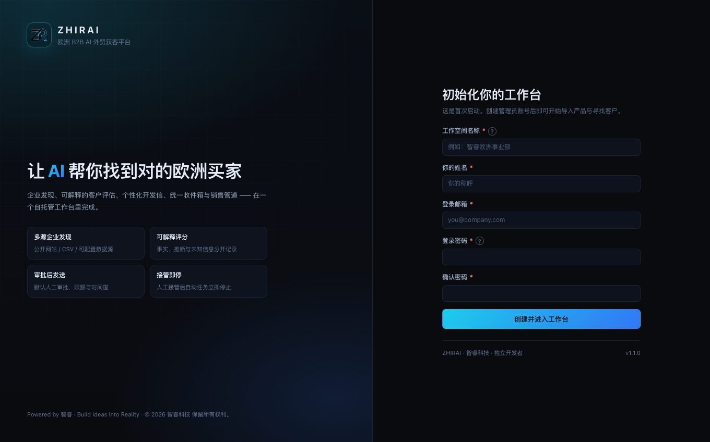

# AI Lead Generation & Outreach CRM

[English](README.md) | [简体中文](README.zh-CN.md)

> A self-hosted AI lead generation and sales CRM workspace: product data → ICP → company discovery → explainable scoring → personalized drafts → human approval → email follow-up → reply classification → pipeline.

No automatic bulk sending by default. Desktop test builds ship with global sending paused.

**Latest version:** `1.1.0-1025` (2026-10-25)  
**Status:** `BETA`  
**License:** MIT

---

### Screenshot



### Download

[GitHub Releases](https://github.com/zhirai-tech/ai-lead-generation-crm/releases)

- Windows Full: no Node.js required; extract and run `LAUNCH-ZHIRAI.bat`.
- Windows Basic: requires Node.js 22.5+; extract and run `START-WINDOWS-BASIC.bat`.
- macOS: Apple Silicon (arm64) only; extract and open `ZHIRAI-Base.app`.

### Current capabilities

- Companies, contacts, sources and verification records; contact roles and email-confidence levels.
- Product data, images/PDF, specifications, certifications, capacity, MOQ, lead time and keywords.
- ICP: countries/regions, company types, sizes, roles, keywords, exclusions and minimum score.
- Discovery runs, web/CSV sources, email inference and MX validation.
- Rule-based `rules-v1` scoring: product match, company type, region, buying scenario, confidence, contact quality and recency, with factors and exclusion reasons.
- Outreach templates, AI drafts, quality/compliance notes, human approval and send pipeline.
- Inbox, reply classification, suggested replies, human takeover and sales pipeline.
- Local SQLite (WAL), backups, audit log, job queue and usage records.

### Stack

- Node.js >= 22.5 with built-in `node:sqlite`.
- Native ES Modules frontend; no frontend build step.
- SQLite WAL; Electron 45 desktop shell for packaged builds.
- Playwright for optional web discovery.
- Windows Full does not require Node.js; Windows Basic does.

### Run from source

```bash
npm install
cp .env.example .env
npm run init-db
npm start
```

Default URL: `http://127.0.0.1:4173`. The migration gate requires explicit `MIGRATION_EXPECTED_DB_PATH` and `MIGRATION_ALLOWLIST`.

### Tests and limitations

```bash
npm test
```

Latest actual result: 428 tests, 427 passed, 1 skipped, 0 failed.

Not yet fully validated: real-world company discovery, external search, website crawling and real SMTP/IMAP delivery. Customer-qualification accuracy has no real human-labelled benchmark, so no 60%/70% claim is made. The macOS build is unsigned/unnotarized and arm64-only.

### Security

- Do not commit `.env`, databases, keys, logs or customer data.
- Desktop test builds default to `GLOBAL_SEND_PAUSED=1`.
- Configure SPF/DKIM/DMARC, unsubscribe, suppression and human approval before real sending.

### Documentation

- [Project status](PROJECT_STATUS.md)
- [Feature status](FEATURE_STATUS.md)
- [Requirements](REQUIREMENTS.md)
- [Contributing](CONTRIBUTING.md)
- [Project rules](PROJECT_RULES.md)
- [Chinese desktop manual (PDF)](docs/manual/ZHIRAI-AI-Lead-Generation-CRM-1.1.0-1025-Desktop-Manual-zh-CN.pdf)
- [Chinese desktop manual (Word)](docs/manual/ZHIRAI-AI-Lead-Generation-CRM-1.1.0-1025-Desktop-Manual-zh-CN.docx)

### Roadmap

Not implemented yet: real human-labelled accuracy evaluation, more external sources, installer/signing/auto-update. These are plans, not current features.

### License

Project code is licensed under the [MIT License](LICENSE). Redistributions must retain the copyright and permission notice; see [NOTICE](NOTICE). Third-party dependencies, assets and trademarks remain under their respective rights.

---
