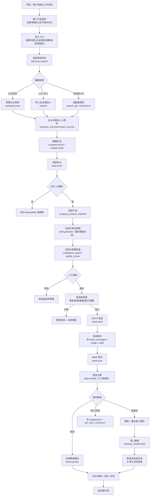
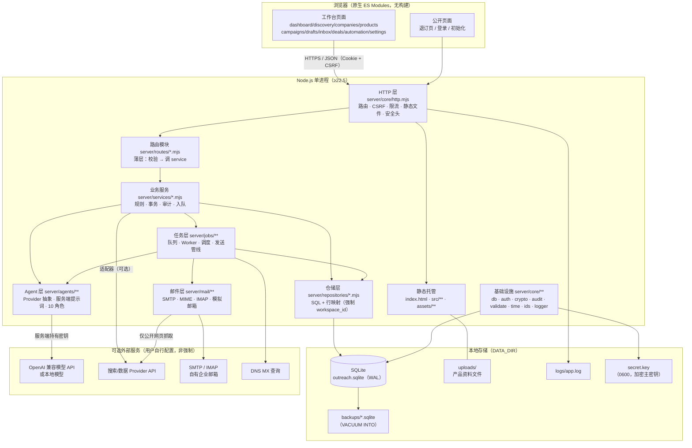
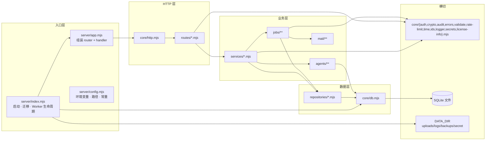
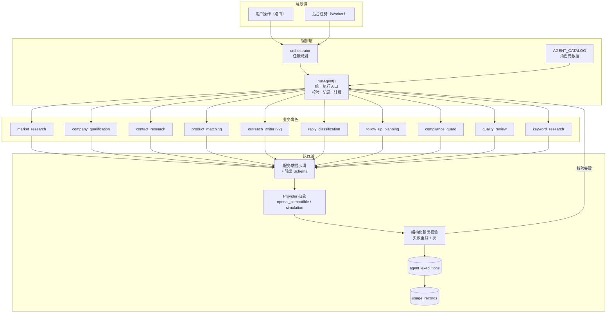
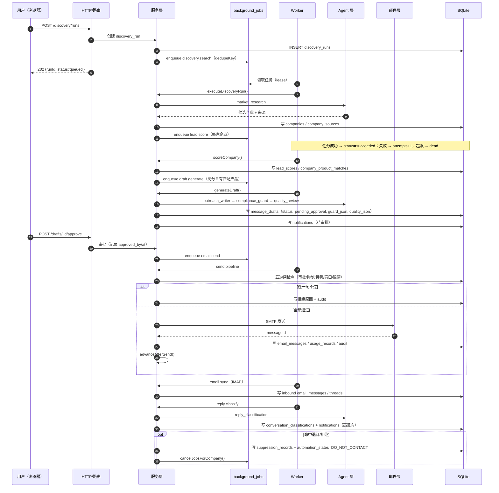
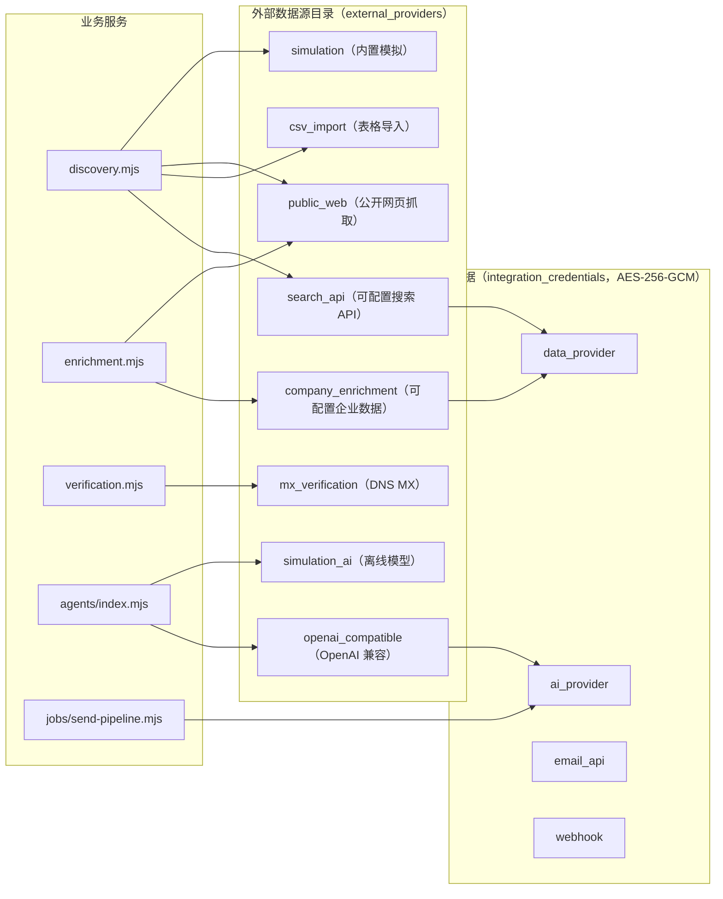
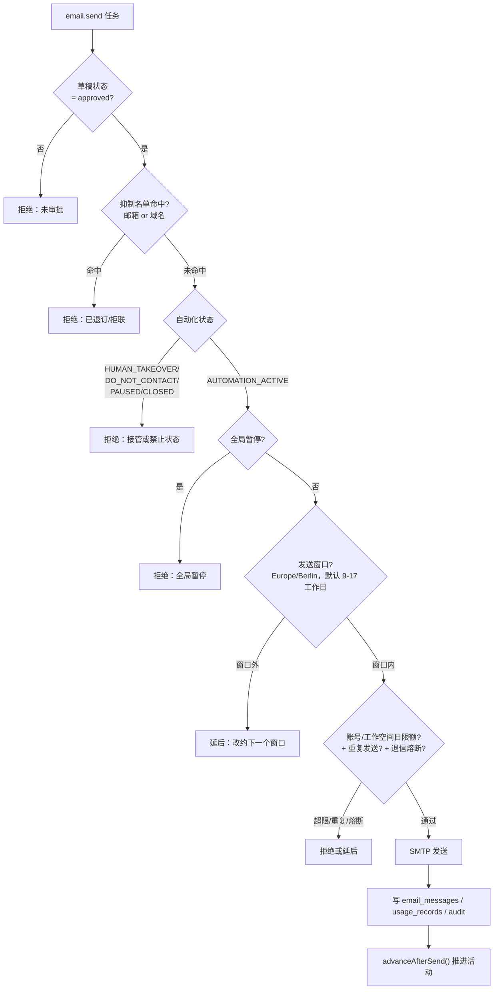
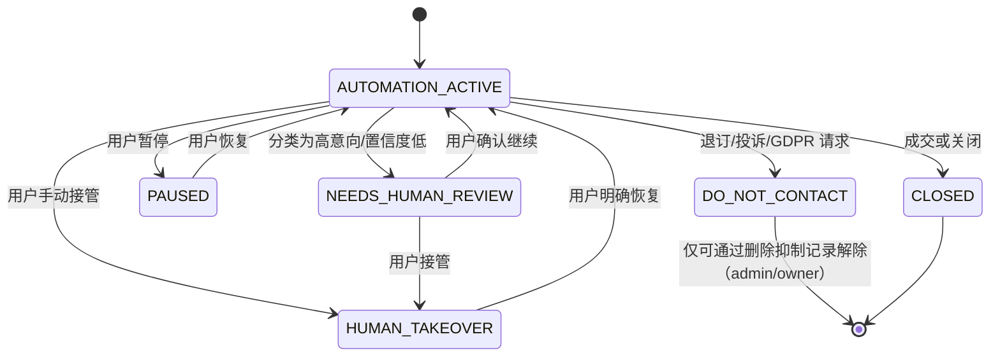
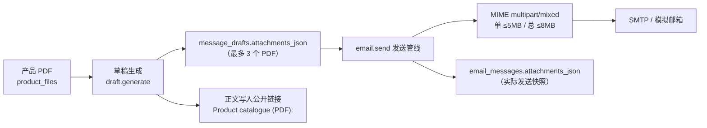
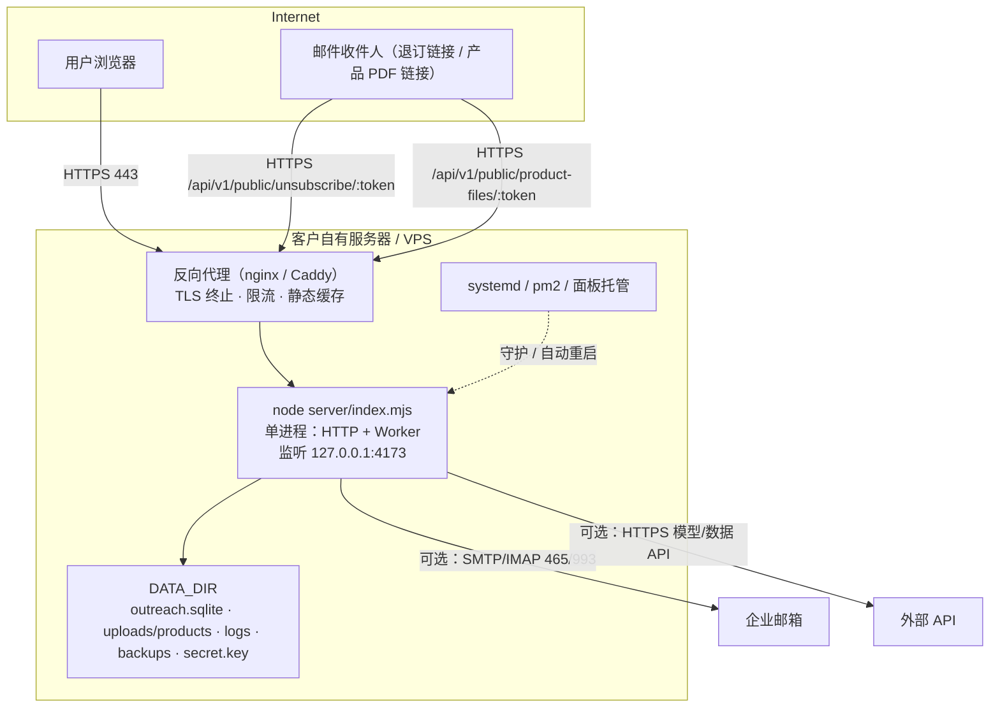

# 系统架构研究方案（Architecture）

> 项目：ZHIRAI Europe B2B AI Outreach Platform（智睿欧洲 B2B AI 外贸获客平台）v1.1.0
> 作者：ZHIRAI · 智睿科技 · 独立开发者
> 对应方案文件第八节「系统架构设计交付要求」19 项。
> 事实纪律：本文标注 **已实现** / **部分实现** / **未实现** / **未验证**。代码状态以 `C:\zhirai-stage\platform` 实际文件与验收结果为准（2026-10-23 复核，含 v1.1 产品媒体/附件/关键词）。

---

## 目录

- [0. 阅读约定与实现状态](#0-阅读约定与实现状态)
- [1. 产品定位与目标用户（交付项 1）](#1-产品定位与目标用户交付项-1)
- [2. 首选技术栈与关键取舍](#2-首选技术栈与关键取舍)
- [3. 业务流程图（交付项 2）](#3-业务流程图交付项-2)
- [4. 系统总架构图（交付项 3）](#4-系统总架构图交付项-3)
- [5. 模块职责与依赖（交付项 4）](#5-模块职责与依赖交付项-4)
- [6. Agent 职责与调用关系（交付项 5）](#6-agent-职责与调用关系交付项-5)
- [7. 数据流与任务执行（交付项 6）](#7-数据流与任务执行交付项-6)
- [8. 数据库实体关系（交付项 7）](#8-数据库实体关系交付项-7)
- [9. 外部服务与适配器（交付项 8）](#9-外部服务与适配器交付项-8)
- [10. 邮件发送、回复识别与人工接管（交付项 9）](#10-邮件发送回复识别与人工接管交付项-9)
- [11. 安全、隐私与合规设计（交付项 10）](#11-安全隐私与合规设计交付项-10)
- [12. 独立部署架构（交付项 11）](#12-独立部署架构交付项-11)
- [13. 商业分发与许可证策略（交付项 12）](#13-商业分发与许可证策略交付项-12)
- [14. 开源项目参考清单（交付项 13）](#14-开源项目参考清单交付项-13)
- [15. 各项目许可证与适用范围（交付项 14）](#15-各项目许可证与适用范围交付项-14)
- [16. 只研究 vs 可能采用（交付项 15）](#16-只研究-vs-可能采用交付项-15)
- [17. 外部服务：用途/费用/替代（交付项 16）](#17-外部服务用途费用替代交付项-16)
- [18. 已知风险与待验证事项（交付项 17）](#18-已知风险与待验证事项交付项-17)
- [19. 开发前必须作出的关键决定（交付项 18）](#19-开发前必须作出的关键决定交付项-18)
- [20. 商业化可行性与技术限制（交付项 19）](#20-商业化可行性与技术限制交付项-19)
- [附录 A：当前实现状态矩阵](#附录-a当前实现状态矩阵)
- [附录 B：19 项交付 ↔ 实现对照与验收结果](#附录-b19-项交付--实现对照与验收结果)
- [附录 C：关键数字速查](#附录-c关键数字速查)

---

## 0. 阅读约定与实现状态

| 标记 | 含义 |
| --- | --- |
| ✅ 已实现 | 代码已存在于工作区，且至少经过单元/集成测试或真实 HTTP 调用（会在文中说明验证方式） |
| 🟡 部分实现 | 主链路已实现，但存在明确的边界/缺口（如保留清理任务、彻底删除工具） |
| ⚪ 未实现 | 规划中，v1.0 不提供 |
| 🔶 未验证 | 已写代码但未做端到端运行验证（如真实外网 SMTP/IMAP、真实模型 API） |

> 本文初稿写作时后端模块在并行开发；**最终版已按实际代码、自动化测试与验收结果复核**（见附录 A / 附录 B）。如与代码冲突，以代码为准并在 [CHANGELOG.md](../CHANGELOG.md) 记录差异。

---

## 1. 产品定位与目标用户（交付项 1）

### 1.1 一句话定位

**面向欧洲 B2B 市场的、可自托管、可闭源商业分发的 AI 外贸获客工作台**：从"产品 → ICP → 目标企业 → 可解释评分 → 个性化开发信 → 人工审批 → 发送 → 回复识别 → 真人接管 → CRM 成交"形成闭环，但**默认不自动群发**。

### 1.2 不是什么（边界声明）

- 不是邮件群发器：默认每条外发邮件都需人工审批（`settings.outreach.requireApproval = true`、`autoSendEnabled = false`）。
- 不是通用 CRM：CRM 只是获客闭环的承载层，不做工单、财务、进销存。
- 不是开源拼装包：0 第三方运行时依赖，0 参考项目代码（见 [RESEARCH.md](./RESEARCH.md)、[LICENSE-REGISTER.md](./LICENSE-REGISTER.md)）。
- 不是 LinkedIn/WhatsApp 自动化工具：不实现此类通道（合规与平台 ToS 风险高），见 [ROADMAP.md](./ROADMAP.md)。

### 1.3 目标用户

| 用户类型 | 画像 | 核心诉求 | 对应能力 |
| --- | --- | --- | --- |
| 外贸业务员 / SOHO | 1–3 人，自己做客户开发 | 少而准的线索 + 高质量开发信 | 发现、评分、草稿、审批、收件箱 |
| 中小外贸企业销售团队 | 3–20 人，多产品线 | 多工作空间/角色、活动管理、交接 | 成员/角色、campaign、接管、CRM 管道 |
| 汽配/新能源供应链厂商 | 产品参数复杂、认证要求多 | 不编造事实、可追溯来源 | 产品资料库、事实约束提示词、来源记录 |
| 独立开发者 / 二次分发者 | 需要交付源码给客户 | 可部署、可迁移、许可证清晰 | 零依赖部署、备份恢复、许可证登记 |

### 1.4 首批行业场景

汽车零部件进口商/经销商/制造商/售后市场企业，以及新能源汽车供应链（如电池包支架）。**但业务逻辑不写死**：行业、国家、企业类型、产品均由数据驱动（`icps`、`products`、`discovery_runs.query_json`）。

---

## 2. 首选技术栈与关键取舍

> 每个决定均写明「选择 / 理由 / 替代方案 / 代价」。完整 ADR 见 [DECISIONS.md](./DECISIONS.md)。

### 2.1 一览

| 层 | 选择 | 版本/形态 |
| --- | --- | --- |
| 运行时 | Node.js | **≥ 22.5**（内置 `node:sqlite`） |
| 语言 | JavaScript ESM（`.mjs`） | 全仓 `"type": "module"` |
| HTTP | 自写微型框架 `server/core/http.mjs` | 路由/CSRF/限流/静态文件/JSON 错误 |
| 数据库 | SQLite（WAL） | `node:sqlite` 的 `DatabaseSync`，单文件 `server/data/outreach.sqlite` |
| 迁移 | 编号 `.sql` + `schema_migrations` 表 | `001_init.sql`、`002_product_media_attachments.sql` |
| 队列 | 数据库任务表 + 进程内 Worker | `background_jobs` |
| 文件存储 | 本地 `uploads/` + SQLite 元数据 | 产品图片/PDF：`uploads/products/<workspace>/<product>/<fileId>.<ext>`；DB 存相对路径 |
| 前端 | 原生 HTML/CSS/ES Modules | 无构建步骤，`index.html` + `src/**` |
| Agent | 自写 Provider 抽象（OpenAI 兼容 + 模拟） | `server/agents/**` |
| 邮件 | 自写 SMTP/IMAP 客户端 + MIME 构建 | `server/mail/**`（Node 内置 `net`/`tls`） |
| 部署 | 单进程 + 静态文件 | 面板/系统服务/反向代理均可 |

### 2.2 决策 D1：Node.js + SQLite 零依赖

| 项 | 内容 |
| --- | --- |
| **选择** | Node ≥22.5 + 内置 `node:sqlite`，`package.json` 无 `dependencies` |
| **理由** | ① 交付给客户"解压即跑"，无需 `npm install`、无供应链攻击面；② SQLite 单文件便于备份/迁移（`VACUUM INTO`）；③ 自托管 B2B 客户数据量级（万级企业、十万级联系人）下 SQLite 足够；④ 零依赖是"商业分发 + 源码交付"的最强卖点之一 |
| **替代方案** | PostgreSQL + Prisma/Knex（功能强、并发好，但引入 npm 依赖与数据库运维）；MySQL（同上）；DuckDB（分析强、OLTP 弱） |
| **代价** | 单写者（WAL 下并发写有限）；无连接池；`node:sqlite` 仍是实验特性（需 `silence-sqlite-warning.mjs` 静默警告）；水平扩展困难；需要自己写迁移/查询构建 |

### 2.3 决策 D2：单体应用 + 内置 Worker（不做微服务）

| 项 | 内容 |
| --- | --- |
| **选择** | HTTP API + 静态前端 + 后台 Worker 跑在同一进程；任务持久化在 `background_jobs` |
| **理由** | ① 真实负载是"每天几十到几千封邮件 + 若干 AI 调用"，单体足够；② 单进程让"接管后取消任务"可用一把事务完成；③ 部署 = 一个 node 进程，客户 IT 成本最低；④ 避免 Redis/RabbitMQ 带来的运维与许可证问题 |
| **替代方案** | Redis + BullMQ（需要 Redis）；独立 Worker 进程（需要进程守护与更复杂的取消语义）；云队列（数据出境风险） |
| **代价** | 无法水平扩展；Worker 崩溃会中断正在执行的任务（用租约 `lease_until` 恢复）；CPU 密集任务会阻塞 HTTP（AI 与网络 IO 为异步，风险可控，见 [SECURITY.md](./SECURITY.md) 已知限制） |

### 2.4 决策 D3：原生前端（无框架、无构建）

| 项 | 内容 |
| --- | --- |
| **选择** | `index.html` + 原生 ES Modules + CSS；服务端静态托管 |
| **理由** | ① 无 node_modules、无构建链、无 source map 泄露风险；② 与"零依赖"一致；③ 数据密集型表格用原生 `<table>` + 虚拟滚动足够；④ 源码即产物，客户可审计 |
| **替代方案** | React/Next.js（生态强、组件多，但引入构建与依赖）；Vue/Svelte（同上）；服务端模板（交互弱） |
| **代价** | 组件复用靠自建约定；复杂交互（拖拽管道、富文本）开发成本高；无类型检查；页面多了以后需要自律的目录规范 |

### 2.5 决策 D4：服务端提示词 + Agent Provider 抽象

| 项 | 内容 |
| --- | --- |
| **选择** | 提示词存放在服务端文件（`server/agents/*`），前端永不接触；模型通过 `Provider` 接口接入（OpenAI 兼容 + 内置 simulation） |
| **理由** | ① 提示词是核心资产，放到前端等于公开（见全局安全规则 §8）；② 换模型不重写业务（方案 §6 要求）；③ 默认 `simulation` 让客户零成本试用与跑测试 |
| **替代方案** | 提示词存数据库（灵活但难以版控）；前端拼提示词（泄露）；硬编码单一供应商（锁定） |
| **代价** | 提示词迭代需发版；Provider 抽象层需要做结构化输出校验与重试；模型差异（JSON 遵循度）需在适配层吸收 |

### 2.6 决策 D5：默认人工审批 + 接管优先

| 项 | 内容 |
| --- | --- |
| **选择** | `requireApproval=true`、`autoSendEnabled=false` 为默认；接管状态机在发送管线上强制拦截 |
| **理由** | ① 欧洲 B2B 冷邮件必须在"可解释、可撤回、可追责"的前提下使用；② 域名声誉是客户最贵的资产，误发一次可能毁掉；③ 方案 §7/§9 明确要求 |
| **替代方案** | 默认全自动（增长快但风险高、易被封）；纯手工（无效率） |
| **代价** | 需要用户每天点审批（设计上支持批量审批）；v1.0 的"自动"能力被刻意削弱 |

---

## 3. 业务流程图（交付项 2）



**流程关键控制点**：① 每条外部数据必须可追溯来源；② 评分必须可解释；③ 草稿必须经合规+质量双检；④ 发送前必须过"审批 + 抑制 + 接管 + 窗口 + 限额"五道闸；⑤ 接管后 AI 不得自动动作。

---

## 4. 系统总架构图（交付项 3）



**架构要点**：

1. **单向依赖**：`routes → services → repositories → core/db`。路由不写 SQL，仓储不做业务规则。
2. **Agent 与 Worker 都只能通过 service 层访问数据**，不得直接改表（方案 §6 要求）。
3. **所有密钥只在服务端**：`.env` 与 `integration_credentials`（AES-256-GCM 加密）都只被 Node 进程读取；前端拿不到任何 Provider 密钥。
4. **零强制外部依赖**：不接 AI 也能跑（simulation Provider）；不接真实邮箱也能跑（模拟邮箱）。

---

## 5. 模块职责与依赖（交付项 4）

### 5.1 分层依赖图



### 5.2 模块职责表

| 模块 | 职责 | 不做什么 | 依赖 | 状态 |
| --- | --- | --- | --- | --- |
| `server/config.mjs` | 读取 `.env`/环境变量；路径、端口、TTL、Worker 参数 | 不读数据库 | `node:fs` | ✅ |
| `server/index.mjs` | 建目录、初始化密钥、打开库、迁移、监听、启动 Worker、优雅退出 | 不含业务逻辑 | config/db/logger/app/worker | ✅ |
| `server/app.mjs` | 组装 `Router` 与 `createApp`，返回 `http.Server` | 不注册具体路由 | core/http、routes/index | ✅ |
| `server/core/http.mjs` | 路由匹配、Body 解析、Cookie、鉴权解析、CSRF/Origin 校验、限流、静态文件、安全响应头、JSON 错误 | 不写业务判断 | auth/rate-limit/errors/time | ✅ |
| `server/core/db.mjs` | 单连接、WAL/外键/busy_timeout、语句缓存、`all/get/run/tx`、迁移、JSON 辅助 | 不做租户过滤（由仓储负责） | `node:sqlite` | ✅ |
| `server/core/auth.mjs` | 角色与 capability 矩阵、会话创建/解析/吊销、API Key、首次初始化、改密 | 不做 HTTP 解析 | db/crypto/audit | ✅ |
| `server/core/crypto.mjs` | scrypt 密码哈希、AES-256-GCM 凭据加解密、HKDF、HMAC 签名 token | 不存密钥 | `node:crypto` | ✅ |
| `server/core/audit.mjs` | 审计写入（自动脱敏）、审计查询 | 不做业务判断 | db | ✅ |
| `server/core/validate.mjs` | 类型/格式/范围校验、分页/排序、规范化（邮箱/域名/名称） | 不做权限 | errors | ✅ |
| `server/core/rate-limit.mjs` | 内存滑动窗口限流 | 不做分布式 | 无 | ✅（单实例） |
| `server/core/time.mjs` | ISO UTC、时区转换（发送窗口用 `Intl`） | — | `Intl` | ✅ |
| `server/core/ids.mjs` | 前缀 ULID（`cmp_…`） | — | `node:crypto` | ✅ |
| `server/core/secrets.mjs` | 进程级主密钥（`secret.key`） | — | crypto | ✅ |
| `server/core/logger.mjs` | 结构化日志（自动脱敏）、`logs/app.log` | 不记录明文密钥 | `node:fs` | ✅ |
| `server/db/migrations/001_init.sql`、`002_product_media_attachments.sql` | 40 张业务表、索引、唯一约束；v1.1 以 `ADD COLUMN` 增加关键词/主图/文件类别/附件快照 | — | — | ✅ |
| `server/repositories/*.mjs` | 纯 SQL + 行映射，**每条查询带 `workspace_id`** | 不做业务规则、不发通知 | core/db | ✅ |
| `server/services/*.mjs` | 业务规则、事务、审计、通知、入队；含 `product-files.mjs`（上传/下载/公开链接） | 不解析 HTTP | repositories/core | ✅ |
| `server/routes/*.mjs` | 输入校验 → 调 service → 返回；声明 `auth/capability/rateLimit` | 不写 SQL | services/core | ✅（26 个路由模块 / 161 条路由） |
| `server/agents/**` | Provider 抽象、服务端提示词、11 角色（含 `keyword_research`）、结构化输出校验、执行记录 | 不直接改业务表 | core、services | ✅ |
| `server/jobs/**` | 队列（幂等/租约/重试/取消）、Worker、调度、发送管线（含附件装配） | 不绕过 service | repositories、mail、agents | ✅ |
| `server/mail/**` | SMTP 客户端、MIME 构建（`multipart/mixed` 附件）、IMAP 同步、模拟邮箱 | 不做业务判断 | `node:net`/`node:tls` | ✅ |
| `src/**` | 原生前端页面与组件（产品媒体/关键词、发现国家快捷选择、草稿附件展示） | 不持有密钥/提示词 | HTTP API | ✅（15 个页面模块 / 16 条路由，真实浏览器验收通过） |
| `scripts/*.mjs` | `init-db` / `seed-demo` / `reset-password` / `backup` / `verify-safety` | 不承载业务 | core | ✅（均已随发行包提供） |
| `tests/**` | `node:test`；临时库 + 随机端口 | 不碰 4173 / `server/data` | helpers | ✅（309 项测试：308 通过 / 1 跳过 / 0 失败） |

> 状态说明：✅ = 已实现并有测试/验收覆盖；🟡 = 部分实现（见 §11 与 §18 的边界说明）；⚪ = 未实现。详见附录 A / 附录 B。

### 5.3 文件所有权（并行开发约束）

见 [CONTRACTS.md](./CONTRACTS.md) 第 2 节。共享核心（`server/core/**`、`server/db/**`）只由 Lead 维护，其他模块通过契约函数调用，**禁止绕过分层直接改共享文件**。

---

## 6. Agent 职责与调用关系（交付项 5）

### 6.1 11 个逻辑角色

| # | 角色（role） | 中文名 | 输入 | 输出（结构化） | 关键约束 |
| --- | --- | --- | --- | --- | --- |
| 1 | `orchestrator` | 总编排 | 用户目标 + 当前状态 | 下一步动作、任务计划 | 只做规划，不直接改数据 |
| 2 | `market_research` | 市场研究 | ICP + 国家/行业关键词 | 候选企业列表 + 来源 URL | 必须带来源，不得编造 |
| 3 | `company_qualification` | 企业资格评估 | 企业公开信息 + ICP | 匹配分项、排除原因、置信度 | 区分事实/推断/未知 |
| 4 | `contact_research` | 联系人研究 | 企业 + 目标角色 | 姓名、职位、角色类别、邮箱类型 | 推测邮箱不得标 valid |
| 5 | `product_matching` | 产品匹配 | 产品资料 + 企业业务 | 匹配理由、适用场景 | 只能用产品库事实 |
| 6 | `outreach_writer` | 开发信撰写 | 企业/联系人/产品/语言/**productFiles（v2 新增）** | 主题、正文、变量占位、正文 PDF 链接 | 不得虚构认证/产能/价格/案例；只能引用给定 `publicUrl` |
| 7 | `reply_classification` | 回复分类 | 原始邮件 | 11 类标签、置信度、依据、建议回复 | 不得因一个正面词判定成交 |
| 8 | `follow_up_planning` | 跟进规划 | 线程历史 + 分类 | 下一步动作、时间、话术要点 | 尊重接管/退订状态 |
| 9 | `compliance_guard` | 合规守卫 | 草稿 + 抑制/接管状态 | 通过/拦截 + 理由 | 一票否决 |
| 10 | `quality_review` | 质量审查 | 草稿 + 事实清单 | 问题列表、评分、修改建议 | 不得放过无依据陈述 |
| 11 | `keyword_research` | 关键词研究 | 产品（名称/分类/规格/应用/材料/现有词） | `keywords` / `negativeKeywords` / `searchQueries` / `notes` | 只能基于已填字段扩展；不编造认证/客户；最多 30 词 |

> 角色清单来自方案 §6 + v1.1 新增；`AGENT_CATALOG` 由 `server/agents/index.mjs` 导出（✅ 已实现）。**角色是逻辑职责，不是独立进程**。提示词版本：`outreach_writer@2`（支持 `productFiles[].publicUrl`），其余为 `@1`。

### 6.2 调用关系图



### 6.3 关键机制

1. **统一入口**：所有角色只能通过 `runAgent({ workspaceId, role, input, actorType, actorId, jobId })` 执行；返回 `{ executionId, output, usage }`。
2. **结构化输出**：每个角色有输出 JSON Schema；解析失败重试 1 次，仍失败则抛错并写 `agent_executions.status='failed'` + `error`。
3. **可追溯**：每次执行写 `agent_executions`（输入/输出/模型/token/耗时/成本）与 `usage_records`（`ai_tokens`/`agent_run`）。草稿通过 `message_drafts.generated_by` 指回执行记录。
4. **事实约束**：`outreach_writer`、`product_matching`、`quality_review`、`keyword_research` 的提示词明确"只能引用输入中出现的事实"；草稿保存 `guard_json`（合规检查结果）与 `quality_json`（质量检查结果）。
5. **不可越权**：Agent 不持有数据库句柄、不能直接执行 SQL/HTTP；所有写操作回到 service 层并记审计。
6. **可切换**：`Provider` 由工作空间设置决定（`settings.ai.provider`），无密钥时自动回落内置 `simulation`（确定性输出，便于离线演示与测试）。
7. **关键词生成**（v1.1）：`POST /products/:id/generate-keywords` 同步调用 `keyword_research`；输出经 Schema 校验后写入 `products.keywords_json`；Provider 不可用返回 503，不伪造关键词。

---

## 7. 数据流与任务执行（交付项 6）

### 7.1 任务执行时序（以"发现 → 评分 → 写信 → 审批 → 发送 → 分类"为例）



### 7.2 任务类型清单（12 种，来自 CONTRACTS §6）

| type | payload | 执行方 | 说明 |
| --- | --- | --- | --- |
| `discovery.search` | `{ discoveryRunId }` | t-data | 执行发现搜索 |
| `company.crawl` | `{ companyId, urls? }` | t-data | 抓取官网并抽取 |
| `company.enrich` | `{ companyId }` | t-data | 补全企业与联系人 |
| `contact.verify` | `{ contactId }` | t-data | 语法 + MX 校验 |
| `lead.score` | `{ companyId, productId }` | t-data | 规则评分 + 原因 |
| `draft.generate` | `{ draftId }` | t-crm → t-agents | 生成开发信 |
| `email.send` | `{ draftId }` | t-worker | 发送管线 |
| `email.sync` | `{ accountId }` | t-worker | IMAP/模拟同步 |
| `reply.classify` | `{ messageId }` | t-crm → t-agents | 分类 + 意向 + 通知 |
| `followup.plan` | `{ threadId, messageId }` | t-crm | 跟进建议 |
| `campaign.tick` | `{ campaignId }` | t-crm | 推进活动目标 |
| `maintenance.retention` | `{}` | t-worker | 数据保留清理 |

**队列语义（契约）**：`enqueueJob({ workspaceId, type, payload, dedupeKey, runAt, priority, maxAttempts, createdBy })`；`dedupeKey` 全局唯一（DB 唯一索引 `idx_jobs_dedupe`）；`cancelJobsForCompany(workspaceId, companyId, reason)` 用于接管/退订时批量取消；任务状态机 `queued → running → succeeded | failed → (重试) → dead`，`cancelled` 为中断态；租约 `lease_until` 防止 Worker 崩溃后任务永久卡死。

### 7.3 数据流原则

1. **单一主记录**：企业/联系人只有一份（`companies`/`contacts`），所有模块引用其 `id`，不允许各模块自建重复客户库（方案 §10）。
2. **来源可追溯**：任何外部数据写入必须同时写 `company_sources` / `contact_sources`（`source_type`、`url`、`retrieved_at`、`confidence`）。
3. **验证状态独立**：邮箱可信度放 `contacts.email_status`（`unverified/valid/risky/invalid/inferred`），MX/语法检查结果放 `data_verifications`，不混淆。
4. **AI 输出可审计**：`message_drafts.generated_by` → `agent_executions.id`；`conversation_classifications.agent_execution_id` 同理。
5. **成本可见**：所有外部消耗写 `usage_records`（含 `cost_estimate`），`/api/v1/usage` 汇总。

---

## 8. 数据库实体关系（交付项 7）

- 完整 ER 图、字段说明、唯一约束、索引、保留与迁移策略见 **[DATA-MODEL.md](./DATA-MODEL.md)**。
- 概览：**40 张业务表**（连迁移表 `schema_migrations` 共 41 个表），全部业务表带 `workspace_id`；租户隔离在仓储层 SQL 强制。
- v1.1 新增字段（`002` 迁移，`ALTER TABLE ADD COLUMN`）：`products.keywords_json/main_image_file_id`、`product_files.kind`、`message_drafts.attachments_json`、`email_messages.attachments_json`。业务表数量未变。
- 核心关系（简图）：

```mermaid
erDiagram
    WORKSPACES ||--o{ MEMBERSHIPS : has
    USERS ||--o{ MEMBERSHIPS : in
    WORKSPACES ||--o{ PRODUCTS : owns
    WORKSPACES ||--o{ ICPS : owns
    PRODUCTS ||--o{ ICPS : targets
    PRODUCTS ||--o{ PRODUCT_FILES : has
    PRODUCTS ||--o| PRODUCT_FILES : main_image
    WORKSPACES ||--o{ COMPANIES : owns
    COMPANIES ||--o{ COMPANY_SOURCES : from
    COMPANIES ||--o{ CONTACTS : has
    CONTACTS ||--o{ CONTACT_SOURCES : from
    COMPANIES ||--o{ COMPANY_PRODUCT_MATCHES : matched
    PRODUCTS ||--o{ COMPANY_PRODUCT_MATCHES : matched
    COMPANIES ||--o{ LEAD_SCORES : scored
    PRODUCTS ||--o{ LEAD_SCORES : scored
    WORKSPACES ||--o{ CAMPAIGNS : runs
    CAMPAIGNS ||--o{ CAMPAIGN_STEPS : contains
    CAMPAIGNS ||--o{ CAMPAIGN_TARGETS : enrolls
    CONTACTS ||--o{ CAMPAIGN_TARGETS : enrolled
    WORKSPACES ||--o{ EMAIL_ACCOUNTS : connects
    EMAIL_ACCOUNTS ||--o{ EMAIL_THREADS : groups
    EMAIL_THREADS ||--o{ EMAIL_MESSAGES : contains
    COMPANIES ||--o{ MESSAGE_DRAFTS : draft
    CONTACTS ||--o{ MESSAGE_DRAFTS : to
    MESSAGE_DRAFTS }o--|| EMAIL_MESSAGES : sends
    EMAIL_MESSAGES ||--o{ CONVERSATION_CLASSIFICATIONS : classified
    COMPANIES ||--o{ DEALS : has
    COMPANIES ||--o{ SALES_ACTIVITIES : timeline
    COMPANIES ||--o{ FOLLOW_UP_TASKS : follow
    COMPANIES ||--|| AUTOMATION_STATES : state
    WORKSPACES ||--o{ SUPPRESSION_RECORDS : suppresses
    WORKSPACES ||--o{ INTEGRATION_CREDENTIALS : secrets
    WORKSPACES ||--o{ EXTERNAL_PROVIDERS : adapters
    WORKSPACES ||--o{ AGENT_EXECUTIONS : ai_runs
    WORKSPACES ||--o{ BACKGROUND_JOBS : tasks
    WORKSPACES ||--o{ USAGE_RECORDS : cost
    WORKSPACES ||--o{ AUDIT_EVENTS : audit
    WORKSPACES ||--o{ LEGAL_BASIS_RECORDS : legal
    WORKSPACES ||--o{ NOTIFICATIONS : alerts
    WORKSPACES ||--o{ IMPORT_RUNS : imports
    WORKSPACES ||--o{ DISCOVERY_RUNS : discovery
```

**设计取舍**：不引入通用 EAV/自定义对象引擎（Twenty 路线的代价见 [RESEARCH.md](./RESEARCH.md) §4.6），改为"显式列 + `*_json` 扩展列 + 索引"；产品规格用 `products.specs_json`，不单开 `product_specifications` 表（方案允许合并）。

---

## 9. 外部服务与适配器（交付项 8）

### 9.1 适配器分层



### 9.2 适配器目录（已实现于 `server/services/settings.mjs` 的 `PROVIDER_CATALOG`）

| key | 名称 | category | adapter | 默认启用 | 费用模型 |
| --- | --- | --- | --- | --- | --- |
| `simulation` | 内置模拟数据源 | search | `simulation` | ✅ | 免费 |
| `public_web` | 公开网站抓取 | search | `public_web` | ✅ | 免费（仅公开网页） |
| `csv_import` | CSV / 表格导入 | search | `csv` | ✅ | 免费 |
| `search_api` | 可配置搜索 API | search | `search_api` | ❌ | 按所选服务商计费 |
| `company_enrichment` | 可配置企业数据提供商 | enrichment | `http_enrichment` | ❌ | 按所选服务商计费 |
| `mx_verification` | 域名邮件交换记录校验 | verification | `dns_mx` | ✅ | 免费 |
| `simulation_ai` | 内置模拟模型（离线） | ai | `simulation` | ✅ | 免费 |
| `openai_compatible` | OpenAI 兼容模型接口 | ai | `openai_compatible` | ❌ | 按所选服务商计费 |

**设计原则**：业务代码只认"capability"（search/enrichment/verification/ai/email），不认具体供应商；启用开关与配置存 `external_providers`，密钥存 `integration_credentials`（密文）。因此换供应商 = 改配置，不改代码。

### 9.3 凭据安全

- 加密：AES-256-GCM，密钥由 `secret.key` 经 HKDF 派生，AAD 绑定 `${workspaceId}:${kind}:${providerKey}`，**密文不可跨工作空间/供应商复用**。
- 读取：仅 `services/settings.mjs#getCredential()` 在服务端解密；任何 API 响应只返回 `hasSecret` 与掩码预览。
- 轮换：删除后重新保存即可；`secret.key` 丢失则所有密文不可解（需重新录入），见 [DEPLOY.md](../DEPLOY.md) 备份说明。

### 9.4 产品媒体与公开文件链接（v1.1，非"外部服务"但属于外部可达面）

| 项 | 设计 |
| --- | --- |
| 存储 | 本地 `DATA_DIR/uploads/products/<workspaceId>/<productId>/<fileId>.<ext>`；DB 存元数据 + 相对路径 |
| 上传 | `POST /products/:id/files`（base64 JSON，≤8 MB，MIME 白名单 PNG/JPEG/WebP/PDF） |
| 认证下载 | `GET /products/:id/files/:fileId`（`data.read`，按租户校验，`inline` + `nosniff`） |
| 公开链接 | 仅 PDF 文档：HMAC 签名 token（180 天），`GET /api/v1/public/product-files/:token`，无需登录 |
| 邮件附件 | 草稿生成时选最多 3 个产品 PDF；发送时装配 `multipart/mixed`（单 ≤5 MB、总 ≤8 MB），快照写 `email_messages.attachments_json` |
| 风险 | 公开链接"持有即可访问"、无按链接撤销；上传无病毒扫描（见 [SECURITY.md](./SECURITY.md) §9.5 / §14） |

---

## 10. 邮件发送、回复识别与人工接管（交付项 9）

### 10.1 发送前五道闸（强制顺序）



| # | 闸门 | 判定依据 | 失败行为 |
| --- | --- | --- | --- |
| 1 | 审批 | `message_drafts.status = 'approved'` | 拒绝并记审计 |
| 2 | 抑制 | `suppression_records`（email/domain） | 拒绝并记审计 |
| 3 | 自动化状态 | `automation_states.state` | 拒绝并记审计 |
| 4 | 全局暂停 | `config.globalSendPaused` 或工作空间 `outreach.autoSendEnabled` 与人工审批设置 | 拒绝 |
| 5 | 窗口/限额/重复/熔断 | 时区窗口、`daily_limit`、`email_messages` 去重、连续退信阈值 | 延后或拒绝 |

### 10.2 回复识别

- 同步：`email.sync` 拉取 IMAP（或模拟邮箱）新邮件，按 `Message-ID`/`In-Reply-To`/`References` 归入线程（`email_threads`），写 `email_messages`（`direction='inbound'`）。
- 分类：`reply.classify` → `reply_classification` Agent → 11 类标签：
  `positive_interest / price_inquiry / quote_request / sample_request / technical_question / follow_up_needed / no_need_now / rejection / unsubscribe / auto_reply / unknown`。
- 落库：`conversation_classifications` 保存 `label`、`confidence`、`intent_score`、`evidence_json`（引用原文片段）、`rationale`、`suggested_reply`、`status`（`ai_suggested/user_confirmed/user_corrected`）、`agent_execution_id`。
- 提醒：高意向（如 `price_inquiry`/`quote_request`/`sample_request`/`positive_interest` 且置信度达标）→ `notifications`（severity=`critical`，类型 `high_intent`）。
- **不做的事**：不因单个正面词判定"成交"；不自动回复（默认），只生成建议。

### 10.3 人工接管（最高优先级安全机制）



**接管原子操作（契约要求）**：

1. 单事务更新 `automation_states.state = 'HUMAN_TAKEOVER'`（唯一约束 `(workspace_id, company_id)`，UPSERT）。
2. 取消该客户未发送的 `follow_up_tasks`（`status='pending'` → `cancelled`）。
3. 调用 `cancelJobsForCompany(workspaceId, companyId, 'human_takeover')` 取消 `background_jobs` 中 queued 任务。
4. 写 `audit_events`（action=`automation.takeover`）。
5. **发送前再次校验状态**（不是只在接管时校验一次）。
6. 保留全部历史邮件、分类与草稿（不删除）。
7. 恢复自动化只允许从 `HUMAN_TAKEOVER / PAUSED / NEEDS_HUMAN_REVIEW` → `AUTOMATION_ACTIVE`；`DO_NOT_CONTACT` **不能**通过"恢复自动化"按钮解除，必须先由 admin/owner 删除 `suppression_records`。

> 测试要求（CONTRACTS §9）：必须用真实任务队列 + 数据库状态 + 发送路径验证，不能只测前端按钮。**已用 `scripts/verify-safety.mjs` 在真实运行实例完成 16/16 端到端安全/媒体验收**（审批→队列→Worker 发送、接管拦截、抑制拦截、公开退订、窗口恢复、产品 PDF 上传→公开链接→草稿附件→发送快照），详见附录 B。

### 10.4 邮件附件装配（v1.1）



- 附件来源：草稿关联活动的产品，或企业已匹配产品；只取 `application/pdf`。
- 正文链接：提示词 v2 要求最多引用两个唯一 `publicUrl`；发送管线在退订段之前补齐缺失链接。
- 失败策略：附件缺失/超限/类型不允许 → 记录 warning 并跳过，**不整封失败**（保证业务连续性）。
- 审计：发送结果包含 `attachmentCount` 与 `attachmentWarnings`。

---

## 11. 安全、隐私与合规设计（交付项 10）

详见 **[SECURITY.md](./SECURITY.md)** 与 **[COMPLIANCE.md](./COMPLIANCE.md)**。概要：

| 领域 | 设计 | 状态 |
| --- | --- | --- |
| 认证 | 会话 Cookie（HttpOnly，仅存 SHA-256 哈希）+ API Key（`zrk_…`，仅存哈希） | ✅ |
| 密码 | scrypt（N=16384,r=8,p=1）+ 每用户盐 + 常数时间比较；最少 10 位且含字母数字 | ✅ |
| CSRF | 双提交 Cookie（`zr_csrf` 可读）+ `X-CSRF-Token`；同时校验 `Origin` | ✅ |
| 授权 | 服务端 capability 矩阵（4 角色 × 25 能力）；不信任前端 role/workspaceId | ✅ |
| 租户隔离 | 所有业务表 `workspace_id`；仓储层强制过滤；会话绑定单一工作空间 | ✅（含跨工作空间测试） |
| 密钥 | `.env` 只在服务端；集成凭据 AES-256-GCM + HKDF；日志/审计自动脱敏 | ✅ |
| 限流 | 登录 10/min、初始化 5/min、健康检查 120/min、退订 30/min；内存滑动窗口 | ✅（单实例） |
| 响应头 | CSP（`default-src 'self'`）、`X-Frame-Options: DENY`、`nosniff`、`Referrer-Policy`、`Permissions-Policy` | ✅ |
| 静态文件 | 仅 `src/ assets/ admin/ index.html favicon manifest`；禁止 `server/ docs/` 与 `..` | ✅ |
| 发送安全 | 五道闸 + 退订链接 + 抑制名单 + 接管 | ✅（E2E 16/16，附录 B） |
| 媒体/附件安全 | 上传 MIME 白名单 + 8 MB 上限 + 路径遍历防护；公开 PDF 链接 HMAC/180 天/租户校验；附件 5 MB/8 MB 限制 | ✅（测试 + E2E 覆盖；病毒扫描 ⚪、按链接撤销 ⚪） |
| Agent 安全 | 提示词服务端、无 DB 句柄、工具最小权限、注入防护（输入隔离 + 输出校验） | ✅（实现 + 测试；真实模型质量 🔶 未验证） |
| 审计 | 关键动作全部写 `audit_events`（含 before/after，自动脱敏） | ✅ |
| 数据保留 | `settings.retention`（消息 730 天、联系人 1095 天、任务 30 天、审计 730 天） | 🟡（配置已实现；`maintenance.retention` 任务已注册，清理效果 🔶 未实测） |
| 导出/删除 | 企业/联系人导出 API；删除为软删（`deleted_at`）；工作空间删除需 owner | 🟡（导出 ✅；彻底删除/匿名化工具 ⚪） |

---

## 12. 独立部署架构（交付项 11）



**部署形态**：

| 形态 | 说明 | 适用 |
| --- | --- | --- |
| 单机直跑 | `node server/index.mjs`，前端同源 | 试用、内网 |
| 反向代理 + HTTPS | nginx/Caddy 终止 TLS，`TRUST_PROXY=1` | 生产（推荐） |
| 面板托管 | Node 项目，启动文件 `server/index.mjs`，端口 4173 | 常见虚拟主机面板 |
| 进程守护 | systemd / pm2 / Windows 服务 | 生产必备 |

**不提供的形态**：Kubernetes、多副本共享 SQLite、Serverless（文件系统与长连接不适合）。原因见 [DECISIONS.md](./DECISIONS.md) ADR-001。

---

## 13. 商业分发与许可证策略（交付项 12）

| 项 | 策略 |
| --- | --- |
| 产品名 | **ZHIRAI Europe B2B AI Outreach Platform**（中文：智睿欧洲 B2B AI 外贸获客平台） |
| 版权归属 | `© 2026 智睿科技 保留所有权利。` 作者：ZHIRAI · 智睿科技 · 独立开发者 |
| 代码许可 | 专有 / `UNLICENSED`（见根目录 [LICENSE](../LICENSE)）：未经书面商业授权不得复制、分发、转售、SaaS 化提供 |
| 商业授权 | ① 软件授权（自托管份数/席位）；② 源码授权（含二次开发权）；③ 白标/OEM；均需签署合同（联系 xtang3125@gmail.com） |
| 发行版本 | 语义化版本 `v1.1.0`；`CHANGELOG.md` 记录；zip 根目录平铺（见 [DEPLOY.md](../DEPLOY.md)） |
| 依赖清单 | [LICENSE-REGISTER.md](./LICENSE-REGISTER.md)：当前 0 个运行时 npm 依赖、0 个第三方代码 |
| 第三方通知 | 未来引入第三方时须登记版本/许可证/版权声明/分发影响，并随发行物附带通知文件 |
| 参考项目 | [RESEARCH.md](./RESEARCH.md)：仅研究，不进入构建产物 |
| 源码分发 | 客户购买源码授权后获得完整 `server/`、`src/`、`docs/`、脚本；密钥与数据不随源码分发 |
| 升级迁移 | 编号 SQL 迁移 + `schema_migrations`；升级只需替换代码并重启（迁移自动执行） |
| 密钥保护 | `.env`、`server/data/secret.key`、`outreach.sqlite` 不入库、不打包、不随源码交付 |

---

## 14. 开源项目参考清单（交付项 13）

见 [RESEARCH.md](./RESEARCH.md) §3（A/B/C/D 分类总表）与 §4（逐项目）。摘要：

| 项目 | 许可证 | 分类 | 用法 |
| --- | --- | --- | --- |
| AgentSDR | MIT | A | 研究 Agent 分工/审批/多组织 |
| OpenOutreach | GPL-3.0 | C | 研究可解释评分流程 |
| Quick-Enrich-Tools | MIT | A | 研究阶段化流水线 |
| OpenEnrich | AGPL-3.0 | C | 研究分级瀑布与成本控制 |
| NakatomiCRM | MIT | A | 研究 Agent 友好接口 |
| Twenty CRM | AGPL-3.0 + 商业 + MIT 混合 | C | 研究 CRM 数据模型 |
| Mautic | GPL-3.0-or-later | C | 研究分群/活动/触发 |
| n8n | Sustainable Use License | D | 参考任务状态机通用模式 |

---

## 15. 各项目许可证与适用范围（交付项 14）

- **逐项目许可原文要点、核验时间、证据**见 [RESEARCH.md](./RESEARCH.md) §4。
- **本项目第三方依赖登记（当前为空）**见 [LICENSE-REGISTER.md](./LICENSE-REGISTER.md)。
- 一句话结论：**A 类仅代表"许可证允许"，不代表"已采用"；本项目当前不采用任何第三方代码。**

---

## 16. 只研究 vs 可能采用（交付项 15）

| 项目 | 只研究 | 可能采用（未来，需审批） | 当前决定 |
| --- | --- | --- | --- |
| AgentSDR | ✅ | 否（其具体依赖/素材未核验） | 仅研究 |
| OpenOutreach | ✅ | 否（GPL） | 仅研究 |
| Quick-Enrich-Tools | ✅ | 否（低频维护 + 依赖未核验） | 仅研究 |
| OpenEnrich | ✅ | 否（AGPL） | 仅研究 |
| NakatomiCRM | ✅ | 否（体量小、功能重合） | 仅研究 |
| Twenty | ✅ | 否（AGPL + 商业文件 + 体量过大） | 仅研究 |
| Mautic | ✅ | 否（GPL + PHP 栈） | 仅研究 |
| n8n | ✅ | 否（SUL 禁止商业分发） | 仅研究 |

**未来可考虑的宽松许可第三方组件类型**（非当前依赖）：SMTP/MIME 解析库、CSV 解析库、日期/时区库、Markdown 渲染库——**引入前必须走 [LICENSE-REGISTER.md](./LICENSE-REGISTER.md) 的登记流程**。

---

## 17. 外部服务：用途/费用/替代（交付项 16）

见 [RESEARCH.md](./RESEARCH.md) §7。要点：**本项目不强制任何外部付费服务**；默认离线可运行（simulation Provider + 模拟邮箱）；所有外部消耗记录在 `usage_records`，并受 `settings.limits` 上限约束。

---

## 18. 已知风险与待验证事项（交付项 17）

| # | 风险/待验证 | 影响 | 当前缓解 | 后续动作 |
| --- | --- | --- | --- | --- |
| 1 | `node:sqlite` 仍标注实验特性 | 升级 Node 可能变更 API | 锁定 `engines >=22.5`；启动静默警告 | 跟踪 Node 发布说明；封装在 `core/db.mjs` 单点 |
| 2 | SQLite 单写者 | 高并发写会等待（`busy_timeout=5000`） | WAL + 短事务 + 语句缓存 | 压测；必要时把审计/用量异步化 |
| 3 | 内存限流 | 多实例部署时限流失效 | 明确"单实例"为支持拓扑 | 若需多实例，先做共享存储方案（ADR 待立） |
| 4 | 真实外网 SMTP/IMAP 未端到端验证 | 发信失败、被判定垃圾邮件 | 发送管线 E2E（受控/模拟邮箱）+ 发送前检查 | 用真实测试邮箱做 E2E；补 SPF/DKIM/DMARC 指引 |
| 5 | Agent 输出质量依赖模型 | 编造事实、语言不当 | 服务端提示词 + 合规/质量双检 + 审批 | 建评测集；记录 `quality_json` 趋势 |
| 6 | 抓取公开网页的合规性 | ToS/robots 风险 | 只抓公开页面、声明 UA、限速 | v1.x 解析 robots.txt；文档明确用户责任 |
| 7 | 冷邮件法律基础（GDPR/ePrivacy） | 罚款与投诉 | 合法依据字段 + 退订 + 抑制 + 保留期限 | 逐国核查（见 [COMPLIANCE.md](./COMPLIANCE.md)） |
| 8 | 邮件送达率 | 域名声誉 | 默认人工审批、限额、窗口、熔断 | 发信预热指引；退信处理 |
| 9 | 数据出境（模型 API） | GDPR 跨境传输 | 默认不接外部 API；BYO key 由用户决定 | 文档披露；支持本地模型 |
| 10 | 多语言邮件质量 | 商务沟通效果 | 语言参数 + 人工审批 | 建语言质量抽检 |
| 11 | 占位符（如 `{{...}}`）未替换就发送 | 低级事故 | 发送前检查 | 端到端测试（🟡 已有静态/单测，未做真实模板全覆盖） |
| 12 | 备份恢复未演练 | 数据丢失 | `VACUUM INTO` + 脚本 | 交付前做一次真实恢复演练 |
| 13 | 升级迁移失败 | 服务不可用 | 迁移事务 + 先备份 | 迁移前强制备份提示 |
| 14 | 前端 e2e 自动化缺失 | 回归成本 | 已完成真实浏览器手工验收 | v1.x 引入 Playwright（需评估依赖策略） |
| 15 | 未做渗透测试 | 未知漏洞 | 安全设计 + 审计 | 发布前第三方或自查清单 |
| 16 | 产品 PDF 公开链接被转发（持有即可访问） | 资料泄露 | 仅 PDF 签发、180 天过期、删除文件即失效 | 只上传可公开资料；评估是否需按链接撤销/水印 |
| 17 | 上传文件未做病毒扫描 | 恶意文件风险 | MIME 白名单 + 8 MB + 路径防护 | 企业网关 AV 扫描；后续可集成扫描 |
| 18 | `uploads/` 不在数据库备份内 | 恢复后附件/主图缺失 | 文档与部署清单要求同时复制 | 备份脚本后续可打包 uploads |
| 19 | 磁盘占用增长（PDF/图片） | 存储成本 | 单文件 8 MB + 单产品 100 文件 | 配额/清理策略；监控磁盘 |

---

## 19. 开发前必须作出的关键决定（交付项 18）

| ADR | 决定 | 选择 | 代价 |
| --- | --- | --- | --- |
| ADR-001 | 运行时与数据库 | Node ≥22.5 + `node:sqlite` 零依赖 | 单写者、实验 API、扩展受限 |
| ADR-002 | 进程模型 | 单体 + 内置 Worker | 不能水平扩展 |
| ADR-003 | 队列实现 | 数据库任务表（不用 Redis） | 吞吐低于专用队列 |
| ADR-004 | 前端 | 原生 ES Modules，无构建 | 无组件生态、开发慢 |
| ADR-005 | 模型接入 | Provider 抽象 + 默认 simulation | 适配层复杂度 |
| ADR-006 | 提示词位置 | 仅服务端文件 | 迭代需发版 |
| ADR-007 | 发送默认 | 人工审批 = true | 效率换安全 |
| ADR-008 | 接管语义 | 原子状态 + 取消任务 + 发送前再校验 | 实现复杂度、跨模块契约 |
| ADR-009 | 评分 | 规则优先（`rules-v1`），AI 只做解释增强 | 灵活度不如纯 AI |
| ADR-010 | 许可与商业分发 | 专有许可 + 0 第三方依赖 + 登记册 | 生态组件需自建 |
| ADR-011 | 数据模型 | 显式表 + JSON 扩展，不做 EAV | 扩展字段查询弱 |
| ADR-012 | 多租户 | 共享库 + `workspace_id` 行级隔离 | 依赖开发者纪律 + 测试 |
| ADR-013 | 部署 | 单机 + 反向代理，不做 K8s | 规模上限 |
| ADR-014 | 产品媒体与公开 PDF 链接 | 本地 uploads + HMAC 签名公开链接（180 天，仅 PDF） | 链接持有即可访问、无按链接撤销、需单独备份 uploads |

详细内容（背景/替代/后果）见 **[DECISIONS.md](./DECISIONS.md)**。

---

## 20. 商业化可行性与技术限制（交付项 19）

### 20.1 可行性

| 维度 | 判断 | 依据 |
| --- | --- | --- |
| 市场 | 中高 | 欧洲 B2B 外贸获客是刚需；现有工具要么贵（Apollo/Instantly 等 SaaS），要么开源但强 copyleft 或需繁重运维 |
| 差异化 | 明确 | 零依赖自托管 + 数据留在本地 + 人工审批/接管优先 + 可解释评分 + 可交付源码 |
| 成本结构 | 低 | 无第三方运行时依赖；用户自带模型与邮箱密钥；开发者只需维护代码与文档 |
| 定价空间 | 中 | 可按"自托管授权 + 年度升级"或"源码授权"定价；具体价格未验证（待市场验证） |
| 合规门槛 | 中高 | GDPR/ePrivacy 是硬门槛，反而构成竞争者壁垒（本项目内建合规字段与流程） |

### 20.2 技术限制（必须对客户诚实说明）

1. **单实例**：不支持多副本共享 SQLite；高可用需外部方案。
2. **数据规模**：十万级联系人、百万级邮件消息在 SQLite 下需索引与归档策略（🔶 未压测，仅设计推断）。
3. **无内置计费**：当前版本不含订阅/许可校验服务端；商业授权靠合同与发行物管理。
4. **不内置反垃圾邮件基础设施**：SPF/DKIM/DMARC、IP 预热由客户自行负责。
5. **Agent 质量**：取决于所选模型与提示词版本；不承诺"越用越准"（方案明确禁止）。
6. **不自动加 LinkedIn/WhatsApp**：平台 ToS 与账号风险，当前版本不做。
7. **浏览器兼容**：面向现代常青浏览器（Chrome/Edge/Firefox/Safari 近两年版本）；未做 IE/旧版兼容。
8. **文件存储依赖本地磁盘**：产品 PDF/图片存于 `DATA_DIR/uploads`，数据库备份不含文件；多副本/对象存储未支持，需客户自行备份与容量规划。
9. **公开 PDF 链接是共享凭证**：持有即可访问、180 天过期、无按链接撤销；敏感资料不应上传。

---

## 附录 A：当前实现状态矩阵

> 采集时间：2026-10-23（v1.1 交付前按实际代码与测试复核）。

| 模块 | 状态 | 备注 |
| --- | --- | --- |
| `server/core/**`（db/http/auth/crypto/audit/validate/time/ids/logger/secrets/rate-limit/errors/license-info） | ✅ 已实现 | 测试辅助 `tests/helpers.mjs` |
| `server/db/migrations/001_init.sql` + `002_product_media_attachments.sql` | ✅ 已实现 | 40 张业务表（含迁移表 41）；v1.1 全部 `ADD COLUMN` |
| 认证/工作空间/设置/凭据/审计/通知/用量/运维/健康/公开路由 | ✅ 已实现 | `routes/{auth,workspace,settings,audit,notifications,usage,ops,health,public}.mjs` |
| 数据域（企业/联系人/产品/ICP/发现/导入/评分） | ✅ 已实现 | `routes/{companies,contacts,products,icps,discovery,imports}.mjs` + repositories/services |
| 产品媒体/文件 | ✅ 已实现 | `routes/product-files.mjs` + `services/product-files.mjs`（上传/下载/主图/公开链接） |
| CRM 域（活动/草稿/收件箱/商机/接管/抑制/邮箱账户/仪表盘） | ✅ 已实现 | `routes/{campaigns,drafts,inbox,deals,automation,suppression,email-accounts,dashboard}.mjs` |
| Agent 层 | ✅ 已实现 | Provider（OpenAI 兼容 + simulation）、**11 角色**（含 `keyword_research`）、`outreach_writer@2`、执行记录 |
| 任务队列/Worker/邮件协议/发送管线 | ✅ 已实现 | `jobs/{queue,worker,scheduler,send-pipeline}.mjs`、`mail/{smtp,imap,mime,simulation}.mjs`（含附件） |
| 前端外壳/组件/仪表盘 | ✅ 已实现 | `src/app/**`、`src/components/**`、`src/pages/dashboard.js` |
| 前端业务页面（发现/企业/企业详情/联系人/产品/ICP/活动/草稿与审批/收件箱/商机/自动化/Agent/任务/设置） | ✅ 已实现 | 15 个页面模块 / 16 条路由；真实浏览器验收通过 |
| 脚本（init-db/seed-demo/reset-password/backup/verify-safety） | ✅ 已实现 | `scripts/` 下均已提供（`verify-safety.mjs` 为端到端安全/媒体验收） |
| 测试 | ✅ | `npm test`（`node --test`）：**309 项，308 通过、1 跳过、0 失败**（Node v24.14.0，2026-10-23） |

---

## 附录 B：19 项交付 ↔ 实现对照与验收结果

### B.1 方案第八节 19 项交付对照

| # | 方案要求 | 本文位置 | 实现状态 | 证据 |
| --- | --- | --- | --- | --- |
| 1 | 产品定位和目标用户 | §1 | ✅ | README + 本文 |
| 2 | 业务流程图 | §3 | ✅ | Mermaid 流程图 |
| 3 | 系统总架构图 | §4 | ✅ | Mermaid 架构图 |
| 4 | 模块职责与依赖关系图 | §5 | ✅ | 分层图 + 职责表 + 文件所有权 |
| 5 | Agent 职责和调用关系图 | §6 | ✅ | **11 角色** + `runAgent()` + 执行记录（`server/agents/**`） |
| 6 | 数据流和任务执行流程 | §7 | ✅ | 时序图 + 12 类任务 + 队列语义（`server/jobs/**`） |
| 7 | 数据库实体关系设计 | §8 + [DATA-MODEL.md](./DATA-MODEL.md) | ✅ | 40 张业务表（含迁移表 41，实测） |
| 8 | 外部服务与适配器设计 | §9 | ✅ | 8 个 Provider + 加密凭据 + 本地媒体存储/公开链接 |
| 9 | 邮件发送、回复识别和人工接管机制 | §10 | ✅ | 五道闸 + 附件装配 + 11 类分类 + 6 态接管；E2E 验证 |
| 10 | 安全、隐私和合规设计 | §11 + [SECURITY.md](./SECURITY.md) + [COMPLIANCE.md](./COMPLIANCE.md) | ✅ | 威胁模型 T1–T20 + 生产清单；法律审查 🔶 待外部复核 |
| 11 | 独立部署架构 | §12 + [DEPLOY.md](../DEPLOY.md) | ✅ | Windows/Linux/systemd/nginx/HTTPS/备份恢复（含 uploads） |
| 12 | 商业分发与许可证策略 | §13 + [LICENSE-REGISTER.md](./LICENSE-REGISTER.md) | ✅ | 专有许可 + 0 依赖登记 |
| 13 | 开源项目参考清单 | §14 + [RESEARCH.md](./RESEARCH.md) | ✅ | 8 个项目 |
| 14 | 各项目许可证和适用范围 | §15 + RESEARCH §4 | ✅ | 2026-10-22 读取 LICENSE 核验（仓库级） |
| 15 | 哪些只研究、哪些可能采用 | §16 + RESEARCH §3 | ✅ | A/B/C/D 分类；当前 0 采用 |
| 16 | 外部服务用途、费用、替代 | §17 + RESEARCH §7 | ✅ | 费用为量级参考，需按供应商当期定价复核 |
| 17 | 已知风险与待验证事项 | §18 | ✅ | 19 项风险 + §20.2 技术限制 |
| 18 | 开发前关键架构决定 | §19 + [DECISIONS.md](./DECISIONS.md) | ✅ | 14 条 ADR（选择/理由/替代/代价） |
| 19 | 商业化可行性与技术限制 | §20 | ✅ | 可行性与 9 项限制 |

### B.2 验收结果（2026-10-23，发布负责人执行）

| 层次 | 方式 | 结果 | 备注 |
| --- | --- | --- | --- |
| 自动化测试 | `npm test`（`node --test --test-force-exit "tests/**/*.test.mjs"`） | **309 项：308 通过 / 1 跳过 / 0 失败**（约 3.4s） | 单元 + 集成（租户隔离、审批、接管、发送管线、附件/MIME、SMTP/IMAP 协议层） |
| 端到端安全/媒体验收 | `node scripts/verify-safety.mjs` | **16/16 通过** | v1.0 的审批/接管/抑制/退订/窗口 + v1.1 产品 PDF 上传→公开链接→草稿附件→发送快照 |
| 前端浏览器验收 | 真实浏览器逐页交互 | **15 个页面模块 / 16 条路由通过** | 产品媒体/关键词、发现国家快捷选择、草稿附件展示（v1.1 流程见 [VERIFICATION.md](./VERIFICATION.md)） |
| 静态一致性检查 | 文档链接 / OpenAPI YAML / 路由与表数量 | 通过 | **161 条路由**、40 张业务表、OpenAPI **106 paths / 145 operations / 38 schemas** |

### B.3 仍未验证（必须保留标注）

- **真实外网 SMTP/IMAP**：协议层有单元测试与受控发送验证，但未用真实邮箱服务商做外网收发 E2E。
- **真实模型 API**：OpenAI 兼容 Provider 已实现并有 mock 测试，但未用真实付费模型做质量评估（含 AI 关键词质量）。
- **法律审查**：GDPR/ePrivacy 各国规则未由律师复核（[COMPLIANCE.md](./COMPLIANCE.md) 明确非法律意见）。
- **压测/容量**：未做长时间、大数据量、上传磁盘占用压力测试（§20.2）。
- **备份恢复演练**：脚本与步骤已提供，但未在客户生产数据上演练（含 `uploads/` 文件恢复）。
- **上传文件病毒扫描**、**公开 PDF 链接按条撤销**：当前未实现。
- **公开 PDF 链接在真实邮件客户端**的点击/预览表现：未用 Gmail/Outlook 实收验证。

---

## 附录 C：关键数字速查

| 项 | 值 |
| --- | --- |
| Node 最低版本 | 22.5（`node:sqlite`） |
| 默认端口 / 监听 | 4173 / `127.0.0.1`（`.env` 可改） |
| 数据库 | `server/data/outreach.sqlite`（WAL，外键开，`busy_timeout=5000ms`） |
| 会话有效期 | 168 小时（7 天，可配 1h–365d） |
| 密码哈希 | scrypt N=16384,r=8,p=1，密钥长度 32B |
| 凭据加密 | AES-256-GCM，HKDF-SHA256，AAD 绑定工作空间+类型+供应商 |
| 公开文件 token | HMAC 签名，180 天有效，按工作空间/产品/文件校验 |
| 数据表数量 | 40 张业务表（含 `schema_migrations` 共 41） |
| 路由数量 | 161（方法 × 路径，26 个路由模块） |
| 前端页面 | 15 个页面模块 / 16 条路由 |
| Agent 角色 | 11（含 `keyword_research`；`outreach_writer@2`） |
| 自动化测试 | 309 项（308 通过 / 1 跳过） |
| 安全/媒体 E2E | 16/16（`scripts/verify-safety.mjs`） |
| 产品文件限制 | 图片 PNG/JPEG/WebP、文档 PDF；单文件 8 MB；公开链接仅 PDF、180 天 |
| 邮件附件限制 | 草稿最多 3 个 PDF；发送单 ≤5 MB、总 ≤8 MB |
| 角色 / capability | 4 角色 / 25 能力 |
| 设置分组 | 6（outreach/limits/retention/ai/compliance/enrichment） |
| 外部数据源目录 | 8（3 默认启用 + 2 可配置 + …） |
| 任务类型 | 12 |
| 回复标签 | 11 |
| 自动化状态 | 6 |
| 默认发送窗口 | Europe/Berlin，09:00–17:00，周一至周五 |
| 默认日限额 | 账号 50 封 / 工作空间 50 封（可配） |
| API 前缀 | `/api/v1` |
| 列表默认分页 | 25（最大 100） |
| 请求体上限 | 1.5 MB（路由可覆盖） |

---
<div align="center">

**ZHIRAI · 智睿科技 · 独立开发者**
把想法变成现实 ｜ https://zhirai.cloud
© 2026 智睿科技 保留所有权利。

</div>
