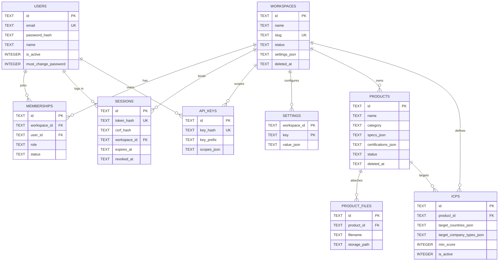
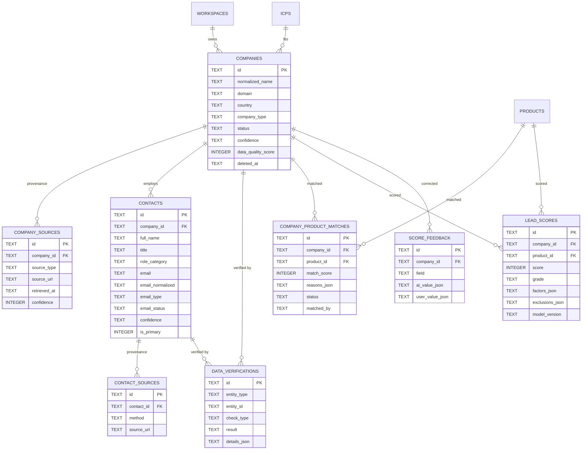
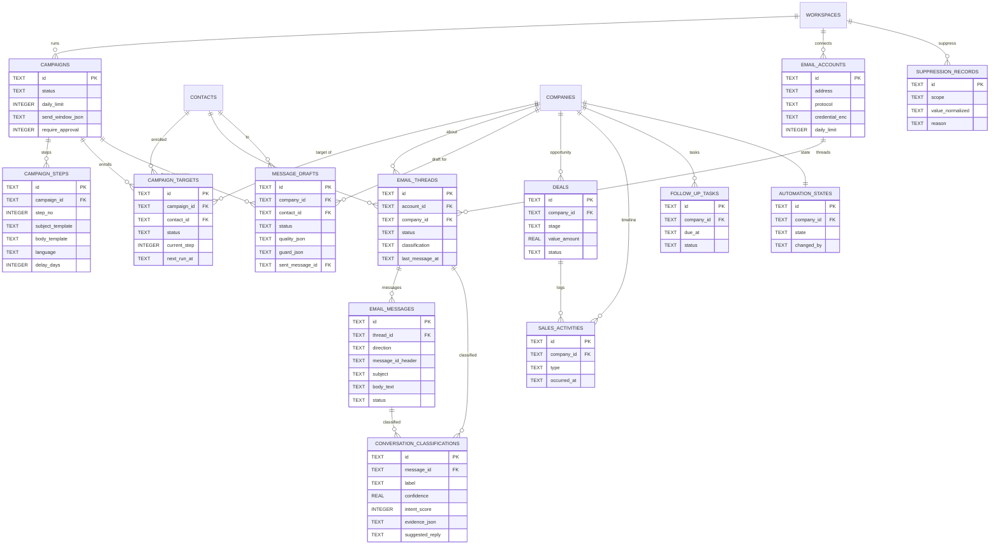

# 数据模型说明（Data Model）

> 项目：ZHIRAI Europe B2B AI Outreach Platform v1.0.0
> 作者：ZHIRAI · 智睿科技 · 独立开发者
> 事实来源：`server/db/migrations/001_init.sql`（**40 张表**），字段名与约束以该文件为准。
> 本文解释"为什么这样设计"与"怎么用"，不替代 SQL。

---

## 目录

- [1. 总览](#1-总览)
- [2. 设计约定](#2-设计约定)
- [3. ER 图（按域拆分）](#3-er-图按域拆分)
- [4. 实体说明与关键字段](#4-实体说明与关键字段)
- [5. 唯一约束与索引](#5-唯一约束与索引)
- [6. 多租户隔离](#6-多租户隔离)
- [7. 业务不变量（数据层）](#7-业务不变量数据层)
- [8. 数据保留与清理](#8-数据保留与清理)
- [9. 迁移策略](#9-迁移策略)
- [10. 与方案原始实体清单的映射](#10-与方案原始实体清单的映射)
- [11. 已知数据风险](#11-已知数据风险)
- [12. 常用查询示例](#12-常用查询示例)

---

## 1. 总览

| 域 | 表 | 数量 |
| --- | --- | --- |
| 身份与租户 | `workspaces`、`users`、`memberships`、`sessions`、`api_keys`、`settings` | 6 |
| 产品与 ICP | `products`、`product_files`、`icps` | 3 |
| 企业与联系人 | `companies`、`company_sources`、`contacts`、`contact_sources`、`data_verifications` | 5 |
| 匹配与评分 | `company_product_matches`、`lead_scores`、`score_feedback` | 3 |
| 活动与外发 | `campaigns`、`campaign_steps`、`campaign_targets`、`email_accounts`、`email_threads`、`email_messages`、`message_drafts` | 7 |
| 回复与 CRM | `conversation_classifications`、`deals`、`sales_activities`、`follow_up_tasks` | 4 |
| 自动化与抑制 | `automation_states`、`suppression_records` | 2 |
| 外部服务 | `integration_credentials`、`external_providers` | 2 |
| 执行与运维 | `agent_executions`、`background_jobs`、`usage_records`、`audit_events`、`notifications` | 5 |
| 合规与导入 | `legal_basis_records`、`import_runs`、`discovery_runs` | 3 |
| **合计** | | **40** |

---

## 2. 设计约定

| 约定 | 说明 |
| --- | --- |
| 主键 | `id TEXT PRIMARY KEY`，前缀 ULID（`cmp_01J…`、`ctc_…`、`job_…`），由 `core/ids.mjs` 生成；按时间可排序、不可枚举 |
| 租户 | 所有业务表带 `workspace_id TEXT NOT NULL REFERENCES workspaces(id) ON DELETE CASCADE` |
| 时间 | 统一 ISO-8601 UTC 字符串（`nowIso()`），如 `2026-10-22T19:00:00.000Z`；SQLite 中可直接字符串比较排序 |
| JSON | 列名以 `_json` 结尾，内容为 JSON 文本；服务层 `JSON.parse/JSON.stringify`，默认 `'{}'` 或 `'[]'` |
| 布尔 | `INTEGER` 存 `0/1`（SQLite 无布尔） |
| 枚举 | 用 `CHECK (col IN (...))` 约束，取值与代码常量一致 |
| 软删除 | `deleted_at TEXT NULL`：`workspaces`、`products`、`companies`、`contacts`、`campaigns` |
| 外键 | 子表 `ON DELETE CASCADE`（如 contact_sources）；"弱引用"用 `ON DELETE SET NULL`（如 `message_drafts.account_id`） |
| 索引 | 以 `(workspace_id, 常用过滤列, 排序列)` 复合索引为主；唯一索引用部分索引（`WHERE ... IS NOT NULL`） |

---

## 3. ER 图（按域拆分）

> 为可读性拆成三张图；`WORKSPACES` 在所有图中都是根，省略重复连线。

### 3.1 身份、产品与 ICP



### 3.2 企业、联系人、来源、评分



### 3.3 外发、回复、CRM、自动化



---

## 4. 实体说明与关键字段

### 4.1 身份与租户

| 表 | 用途 | 关键字段 | 备注 |
| --- | --- | --- | --- |
| `workspaces` | 租户根 | `slug UNIQUE`、`status(active/suspended/deleted)`、`settings_json`、`deleted_at` | 删除用 `deleted_at`，不物理删 |
| `users` | 账号 | `email UNIQUE COLLATE NOCASE`、`password_hash`（scrypt）、`is_active`、`must_change_password` | 全局唯一，一个用户可属多个工作空间 |
| `memberships` | 用户↔工作空间 | `role(owner/admin/member/viewer)`、`status(active/invited/suspended)`、`UNIQUE(workspace_id,user_id)` | v1.0 不支持"邀请"流程，直接建号 |
| `sessions` | 浏览器会话 | `token_hash UNIQUE`（只存哈希）、`csrf_hash`、`workspace_id`、`expires_at`、`revoked_at` | 绑定单一工作空间 |
| `api_keys` | 自动化令牌 | `key_hash UNIQUE`、`key_prefix`、`scopes_json`、`expires_at`、`revoked_at` | 明文只出现一次 |
| `settings` | 工作空间配置 | PK `(workspace_id, key)`、`value_json` | 6 组：outreach/limits/retention/ai/compliance/enrichment |

### 4.2 产品与 ICP

| 表 | 用途 | 关键字段 |
| --- | --- | --- |
| `products` | 产品资料 | `name`、`category`、`sku`、`specs_json`、`applications_json`、`materials`、`certifications_json`、`capacity`、`moq`、`pricing_terms`、`samples`、`lead_time`、`status(active/draft/archived)` |
| `product_files` | 产品资料文件 | `filename`、`mime_type`、`size_bytes`、`storage_path`（在 `DATA_DIR/uploads`） |
| `icps` | 理想客户画像 | `product_id`、`target_countries_json`、`target_regions_json`、`target_company_types_json`、`target_sizes_json`、`target_roles_json`、`include_keywords_json`、`exclude_keywords_json`、`min_score`、`is_active` |

> **事实纪律**：`products` 中的认证/产能/价格/案例是**唯一可信来源**；Agent 不得编造这些字段之外的内容。空字段必须保持空，不得由 AI 填充。

### 4.3 企业与联系人

| 表 | 用途 | 关键字段 | 约束 |
| --- | --- | --- | --- |
| `companies` | 企业主记录 | `name`、`normalized_name`、`domain`、`website`、`country`（ISO2）、`region`、`city`、`company_type`、`industry`、`employee_range`、`revenue_range`、`status(new/qualified/contacted/replied/customer/disqualified/archived)`、`confidence(unverified/low/medium/high)`、`data_quality_score`、`icp_id`、`owner_user_id`、`tags_json`、`deleted_at` | 同工作空间内 `domain` 唯一（非空时） |
| `company_sources` | 企业来源 | `source_type`、`source_name`、`source_url`、`retrieved_at`、`payload_json`、`confidence` | 每条外部数据必须写 |
| `contacts` | 联系人 | `first_name/last_name/full_name`、`title`、`role_category(decision_maker/influencer/gatekeeper/technical/unknown)`、`email`、`email_normalized`、`email_type(business/personal/role/inferred/unknown)`、`email_status(unverified/valid/risky/invalid/inferred)`、`is_primary`、`confidence` | 同工作空间内 `email_normalized` 唯一（非空时） |
| `contact_sources` | 联系人来源 | `source_type`、`source_url`、`method(manual/import/crawl/inference/enrichment/provider)`、`retrieved_at`、`confidence` | 推断邮箱必须 `method='inference'` |
| `data_verifications` | 校验记录 | `entity_type(company/contact)`、`entity_id`、`check_type`、`result(passed/failed/unknown)`、`confidence`、`details_json` | 与 `email_status` 分离，保留原始校验结果 |

### 4.4 匹配与评分

| 表 | 用途 | 关键字段 | 约束 |
| --- | --- | --- | --- |
| `company_product_matches` | 企业↔产品匹配 | `match_score`、`reasons_json`、`evidence_json`、`status(suggested/confirmed/rejected)`、`matched_by(rule/ai/user)`、`reviewed_by` | `UNIQUE(company_id, product_id)` |
| `lead_scores` | 评分结果 | `score`（0–100）、`grade(A/B/C/D)`、`factors_json`（每项依据）、`exclusions_json`、`explanation`、`model_version`（默认 `rules-v1`）、`scored_at` | `UNIQUE(workspace_id, company_id, product_id)`，重新评分覆盖 |
| `score_feedback` | 人工修正 | `field`、`ai_value_json`、`user_value_json`、`reason`、`user_id` | 只收集，不自动训练 |

### 4.5 活动与外发

| 表 | 用途 | 关键字段 | 约束 |
| --- | --- | --- | --- |
| `campaigns` | 销售活动 | `product_id`、`icp_id`、`status(draft/active/paused/archived)`、`daily_limit`（默认 30）、`send_window_json`、`require_approval`（默认 1） | 软删 |
| `campaign_steps` | 活动步骤 | `step_no`、`subject_template`、`body_template`、`language`、`delay_days`、`conditions_json`、`is_active` | `UNIQUE(campaign_id, step_no)` |
| `campaign_targets` | 活动目标 | `company_id`、`contact_id`、`status(enrolled/active/paused/completed/replied/unsubscribed/bounced/failed)`、`current_step`、`next_run_at`、`last_contacted_at` | `UNIQUE(campaign_id, contact_id)` |
| `email_accounts` | 发件邮箱 | `address`、`protocol(smtp_imap/simulation)`、SMTP/IMAP 主机端口、`credential_enc`（加密）、`daily_limit`（默认 50）、`last_sync_at`、`last_error` | `UNIQUE(workspace_id, address)` |
| `email_threads` | 线程 | `account_id`、`company_id`、`contact_id`、`subject`、`last_message_at`、`message_count`、`status(open/waiting/replied/closed/archived)`、`classification` | — |
| `email_messages` | 邮件 | `direction(inbound/outbound)`、`from_address`、`to_addresses_json`、`subject`、`body_text`、`body_html`、`message_id_header`、`in_reply_to`、`references_json`、`status(queued/sending/sent/failed/bounced/received)`、`is_read`、`raw_headers_json` | `UNIQUE(workspace_id, account_id, message_id_header)`（去重） |
| `message_drafts` | 草稿 | `company_id`、`contact_id`、`campaign_id`、`campaign_step_id`、`account_id`、`subject`、`body_text`、`language`、`status(draft/pending_approval/approved/rejected/scheduled/sent/failed/discarded)`、`generated_by`（→agent_executions）、`quality_json`、`guard_json`、`approved_by/at`、`scheduled_at`、`sent_message_id`、`rejection_reason` | 发送前必须 `approved` |

### 4.6 回复与 CRM

| 表 | 用途 | 关键字段 |
| --- | --- | --- |
| `conversation_classifications` | 回复分类 | `thread_id`、`message_id`、`label`（11 类）、`confidence`、`intent_score`、`evidence_json`、`rationale`、`suggested_reply`、`status(ai_suggested/user_confirmed/user_corrected)`、`agent_execution_id` |
| `deals` | 商机 | `company_id`、`contact_id`、`product_id`、`title`、`stage(lead/qualified/proposal/negotiation/won/lost)`、`value_amount`、`currency`（默认 EUR）、`probability`、`expected_close_date`、`status(open/won/lost)`、`lost_reason`、`closed_at` |
| `sales_activities` | 互动时间线 | `company_id`、`contact_id`、`deal_id`、`type(email/call/meeting/note/task/system)`、`subject`、`body`、`occurred_at`、`user_id` |
| `follow_up_tasks` | 待办 | `company_id`、`contact_id`、`campaign_id`、`deal_id`、`due_at`、`type(follow_up/email/call/review/reminder)`、`title`、`notes`、`status(pending/done/cancelled/skipped)`、`assigned_to` |

### 4.7 自动化与抑制

| 表 | 用途 | 关键字段 | 约束 |
| --- | --- | --- | --- |
| `automation_states` | 客户自动化状态 | `company_id`、`state(AUTOMATION_ACTIVE/NEEDS_HUMAN_REVIEW/HUMAN_TAKEOVER/PAUSED/DO_NOT_CONTACT/CLOSED)`、`reason`、`changed_by`、`changed_at` | `UNIQUE(workspace_id, company_id)`（每个客户一行） |
| `suppression_records` | 抑制名单 | `scope(email/domain)`、`value_normalized`、`reason(unsubscribe/hard_bounce/complaint/manual/do_not_contact/gdpr_request)`、`source`、`note` | `UNIQUE(workspace_id, scope, value_normalized)` |

### 4.8 外部服务与执行

| 表 | 用途 | 关键字段 |
| --- | --- | --- |
| `integration_credentials` | 加密凭据 | `kind(ai_provider/data_provider/email_api/webhook)`、`provider_key`、`label`、`credential_enc`（AES-256-GCM）、`config_json`、`status`、`last_checked_at`；`UNIQUE(workspace_id, kind, provider_key)` |
| `external_providers` | 数据源目录 | `key`、`name`、`category(search/enrichment/verification/ai/email)`、`adapter`、`capabilities_json`、`cost_model`、`config_json`、`is_enabled`；`UNIQUE(workspace_id, key)` |
| `agent_executions` | Agent 执行记录 | `agent_role`、`status(queued/running/succeeded/failed/cancelled)`、`input_json`、`output_json`、`prompt_version`、`provider`、`model`、`tokens_in/out`、`cost_estimate`、`latency_ms`、`error`、`job_id`、`started_at/finished_at` |
| `background_jobs` | 任务队列 | `type`、`payload_json`、`status(queued/running/succeeded/failed/cancelled/dead)`、`priority`、`attempts`、`max_attempts`、`run_at`、`lease_until`、`worker_id`、`dedupe_key`、`last_error`、`result_json`、`cost_estimate` |
| `usage_records` | 用量与成本 | `category(ai_tokens/email_sent/data_lookup/agent_run/crawl)`、`agent_role`、`provider`、`model`、`quantity`、`unit`、`cost_estimate`、`currency`（默认 USD）、`job_id`、`agent_execution_id`、`occurred_at` |
| `audit_events` | 审计 | `actor_type(user/agent/system/api_key/anonymous)`、`action`、`entity_type/id`、`before_json/after_json`（脱敏）、`ip`、`user_agent`、`request_id` |
| `notifications` | 站内通知 | `type`、`title`、`body`、`entity_type/id`、`severity(info/success/warning/critical)`、`read_at` |

### 4.9 合规与导入

| 表 | 用途 | 关键字段 |
| --- | --- | --- |
| `legal_basis_records` | 合法依据 | `company_id`、`contact_id`、`basis(legitimate_interest/consent/contract/legal_obligation)`、`source`、`note`、`evidence_json`、`recorded_by`、`recorded_at` |
| `import_runs` | 导入批次 | `kind(companies/contacts/suppression)`、`filename`、`total_rows`、`created_count`、`updated_count`、`skipped_count`、`error_count`、`errors_json`、`status(running/completed/failed)`、`finished_at` |
| `discovery_runs` | 发现批次 | `query_json`、`provider`、`status(queued/running/completed/failed/cancelled)`、`result_count`、`companies_created`、`error`、`started_at/finished_at` |

---

## 5. 唯一约束与索引

### 5.1 唯一约束（业务关键）

| 表 | 唯一键 | 目的 |
| --- | --- | --- |
| `workspaces` | `slug` | 可读标识 |
| `users` | `email`（NOCASE） | 全局账号唯一 |
| `memberships` | `(workspace_id, user_id)` | 一人一租户一行 |
| `sessions` | `token_hash` | 会话唯一 |
| `api_keys` | `key_hash` | 令牌唯一 |
| `settings` | `(workspace_id, key)` PK | 每组设置一行 |
| `companies` | 部分唯一 `(workspace_id, domain) WHERE domain NOT NULL AND domain <> ''` | 同租户同域名只一家企业（防重复） |
| `contacts` | 部分唯一 `(workspace_id, email_normalized) WHERE email_normalized NOT NULL AND email_normalized <> ''` | 同租户同邮箱一个联系人 |
| `company_product_matches` | `(company_id, product_id)` | 匹配唯一 |
| `lead_scores` | `(workspace_id, company_id, product_id)` | 评分唯一（覆盖更新） |
| `campaign_steps` | `(campaign_id, step_no)` | 步骤序号唯一 |
| `campaign_targets` | `(campaign_id, contact_id)` | 同活动同联系人只入组一次 |
| `email_accounts` | `(workspace_id, address)` | 同租户同发件地址唯一 |
| `email_messages` | 部分唯一 `(workspace_id, account_id, message_id_header) WHERE message_id_header NOT NULL AND <> ''` | 邮件去重（IMAP 重复拉取不重复入库） |
| `automation_states` | `(workspace_id, company_id)` | 每个客户一条状态 |
| `suppression_records` | `(workspace_id, scope, value_normalized)` | 抑制唯一 |
| `integration_credentials` | `(workspace_id, kind, provider_key)` | 每类每供应商一条 |
| `external_providers` | `(workspace_id, key)` | 数据源唯一 |
| `background_jobs` | 部分唯一 `(dedupe_key) WHERE dedupe_key NOT NULL AND <> ''` | 任务幂等 |

### 5.2 主要索引（性能关键）

| 索引 | 表 | 列 | 服务场景 |
| --- | --- | --- | --- |
| `idx_companies_workspace` | companies | `(workspace_id, status, created_at)` | 列表 + 状态过滤 |
| `idx_companies_name` | companies | `(workspace_id, normalized_name)` | 名称查重/搜索 |
| `idx_companies_country` | companies | `(workspace_id, country)` | 按国家筛选 |
| `idx_contacts_company` | contacts | `(company_id, is_primary)` | 企业详情页主联系人 |
| `idx_contacts_workspace` | contacts | `(workspace_id, email_status)` | 邮箱状态筛选 |
| `idx_contacts_email` | contacts | `(workspace_id, email_normalized)` 部分 | 邮箱去重 |
| `idx_scores_workspace` | lead_scores | `(workspace_id, score)` | 高分排序 |
| `idx_targets_next_run` | campaign_targets | `(workspace_id, status, next_run_at)` | 调度器取待发目标 |
| `idx_messages_thread` | email_messages | `(thread_id, created_at)` | 线程详情 |
| `idx_messages_workspace` | email_messages | `(workspace_id, direction, received_at)` | 收件箱 |
| `idx_drafts_workspace` | message_drafts | `(workspace_id, status, created_at)` | 待审批列表 |
| `idx_classifications_workspace` | conversation_classifications | `(workspace_id, label, created_at)` | 意向统计 |
| `idx_followups_due` | follow_up_tasks | `(workspace_id, status, due_at)` | 到期提醒 |
| `idx_suppression_lookup` | suppression_records | `(workspace_id, scope, value_normalized)` | 发送前检查 |
| `idx_jobs_claim` | background_jobs | `(status, run_at, priority)` | Worker 领取任务 |
| `idx_jobs_workspace` | background_jobs | `(workspace_id, status, created_at)` | 任务列表 |
| `idx_jobs_dedupe` | background_jobs | `(dedupe_key)` 部分 | 幂等入队 |
| `idx_usage_workspace` | usage_records | `(workspace_id, occurred_at)` | 用量报表 |
| `idx_audit_workspace` | audit_events | `(workspace_id, created_at)` | 审计查询 |
| `idx_audit_entity` | audit_events | `(entity_type, entity_id)` | 实体追溯 |
| `idx_notifications_workspace` | notifications | `(workspace_id, read_at, created_at)` | 未读通知 |
| `idx_discovery_workspace` | discovery_runs | `(workspace_id, created_at)` | 发现批次 |
| `idx_agent_exec_workspace` | agent_executions | `(workspace_id, created_at)` | 执行记录 |
| `idx_memberships_user` | memberships | `(user_id)` | 登录时查用户租户 |

---

## 6. 多租户隔离

1. **表级**：所有业务表 `workspace_id NOT NULL REFERENCES workspaces(id) ON DELETE CASCADE`。
2. **查询级**：仓储层每个 SQL 必须带 `WHERE workspace_id = ?`；跨租户返回 `null`/空。
3. **会话级**：`sessions.workspace_id` 固定；切换工作空间需重新登录。
4. **凭据级**：`integration_credentials` 密文 AAD 绑定 `${workspaceId}:${kind}:${providerKey}`，跨租户不可解密。
5. **唯一约束**：全部以 `workspace_id` 开头，保证"同域名/同邮箱在不同租户可各自存在"。

**注意**：`audit_events.workspace_id` 允许 `NULL`（系统级事件，如未登录失败登录），查询时必须区分。

---

## 7. 业务不变量（数据层）

| # | 不变量 | 数据库/服务保证 |
| --- | --- | --- |
| 1 | 外发草稿必须 `status='approved'` | 发送管线检查；DB 不强制（状态机在服务层） |
| 2 | 抑制名单命中不得发送 | 发送管线查询 `suppression_records` |
| 3 | 接管/禁止状态下不得发送 | 发送管线查询 `automation_states` |
| 4 | 推测邮箱不得 `email_status='valid'` | 服务层规则；`email_type='inferred'` + `email_status='inferred'` |
| 5 | 外部数据必须写来源 | 服务层规则；`company_sources`/`contact_sources` |
| 6 | 退订即 `DO_NOT_CONTACT` | 公开退订路由实现（写抑制 + 状态 + 取消任务） |
| 7 | 每个客户只有一条自动化状态 | `UNIQUE(workspace_id, company_id)` |
| 8 | 任务去重 | 部分唯一索引 `dedupe_key` |
| 9 | 同一邮件不重复入库 | 部分唯一索引 `(workspace_id, account_id, message_id_header)` |
| 10 | 评分可解释 | `factors_json` + `exclusions_json` + `explanation` 必填（服务层） |
| 11 | 企业/联系人主记录唯一 | 域名/邮箱唯一索引 |
| 12 | JSON 列非 null | 默认 `'{}'`/`'[]'` |

---

## 8. 数据保留与清理

| 数据 | 设置键 | 默认 | 清理方式 | 备注 |
| --- | --- | --- | --- | --- |
| 邮件消息 | `retention.messageDays` | 730 | `maintenance.retention` 删除过期 `email_messages`（🔶 待实现） | 线程可保留摘要 |
| 联系人 | `retention.contactDays` | 1095 | 软删或删除长期无互动联系人 | 需先检查是否有商机 |
| 任务 | `retention.jobDays` | 30 | 删除已完成/失败任务 | 保留 `dead` 一段时间便于排查 |
| 审计 | `retention.auditDays` | 730 | 删除过期审计 | 安全追责需要 |
| 用量 | `retention.usageDays` | 730 | 删除过期用量 | 报表用 |
| **抑制名单** | — | **永久** | **不清理** | 合规要求：必须记住反对 |
| 合法依据记录 | — | 永久 | 不清理 | 合规举证 |

**注意**：清理任务必须**排除 `suppression_records` 与 `legal_basis_records`**，否则会导致"已退订的人被再次联系"。

---

## 9. 迁移策略

| 项 | 规则 |
| --- | --- |
| 迁移目录 | `server/db/migrations/`，文件名 `NNN_描述.sql`（如 `001_init.sql`），按名称排序执行 |
| 版本表 | `schema_migrations(name TEXT PK, applied_at TEXT)`；已应用的不重复执行 |
| 执行时机 | 启动时 `migrate()`（`server/index.mjs`）与 `npm run init-db` |
| 事务 | 每个迁移文件在 `BEGIN IMMEDIATE … COMMIT` 中执行；失败回滚并抛错（启动失败） |
| 原则 | **只增不改**：新增表/列/索引；避免破坏性变更。必须改列时：新增列 → 回填 → 切换代码 → 后续版本删旧列 |
| 升级流程 | **先备份**（`VACUUM INTO`）→ 替换代码 → 启动（自动迁移）→ 验证 |
| 回滚 | 代码回滚 + 恢复备份（Sqlite 不支持自动 down 迁移） |
| 命名 | 使用 `ADD COLUMN`（SQLite 支持）；重建表时遵循 SQLite 官方 12 步流程 |

**当前版本**：`001_init.sql`（初始 schema，40 表）。

---

## 10. 与方案原始实体清单的映射

方案第六节列出 31 个候选实体（"研究清单，不是要求机械创建"）。映射如下：

| 方案实体 | 本项目 | 说明 |
| --- | --- | --- |
| Workspace | `workspaces` | 1:1 |
| User | `users` | 1:1 |
| Product | `products` | 1:1 |
| ProductSpecification | `products.specs_json` | **合并**（避免过度设计） |
| IdealCustomerProfile | `icps` | 1:1 |
| Company | `companies` | 1:1 |
| Contact | `contacts` | 1:1 |
| CompanySource | `company_sources` | 1:1 |
| ContactSource | `contact_sources` | 1:1 |
| DataVerification | `data_verifications` | 1:1 |
| CompanyProductMatch | `company_product_matches` | 1:1 |
| LeadScore | `lead_scores` | 1:1 |
| Campaign | `campaigns` | 1:1 |
| CampaignStep | `campaign_steps` | 1:1 |
| EmailAccount | `email_accounts` | 1:1 |
| EmailThread | `email_threads` | 1:1 |
| EmailMessage | `email_messages` | 1:1 |
| MessageDraft | `message_drafts` | 1:1 |
| ConversationClassification | `conversation_classifications` | 1:1 |
| Deal | `deals` | 1:1 |
| SalesActivity | `sales_activities` | 1:1 |
| FollowUpTask | `follow_up_tasks` | 1:1 |
| AutomationState | `automation_states` | 1:1 |
| SuppressionRecord | `suppression_records` | 1:1 |
| IntegrationCredential | `integration_credentials` | 1:1 |
| ExternalProvider | `external_providers` | 1:1 |
| AgentExecution | `agent_executions` | 1:1 |
| BackgroundJob | `background_jobs` | 1:1 |
| UsageRecord | `usage_records` | 1:1 |
| AuditEvent | `audit_events` | 1:1 |
| ConsentOrLegalBasisRecord | `legal_basis_records` | 1:1 |
| **（新增）** | `memberships`、`sessions`、`api_keys`、`settings` | 身份/配置必需 |
| **（新增）** | `product_files` | 产品资料文件 |
| **（新增）** | `campaign_targets` | 活动与联系人的多对多（"Campaign 入组"） |
| **（新增）** | `score_feedback` | 人工修正评分（方案 §5"用户可以修正 AI 判断"） |
| **（新增）** | `notifications` | 高意向提醒 |
| **（新增）** | `import_runs` | 导入批次与错误记录 |
| **（新增）** | `discovery_runs` | 发现批次与结果统计 |

**合并/拆分说明**：
- `ProductSpecification` 合并进 `products.specs_json`：规格是产品的附属数据，单独建表会导致"每产品 N 行"与复杂联表，且不方便展示。
- `CampaignTarget`（方案未列）拆出：活动与联系人是多对多，且需要 `current_step/next_run_at` 状态。
- 未建"Tag"独立表：标签用 `companies.tags_json`（v1.0）。

---

## 11. 已知数据风险

| # | 风险 | 说明 | 缓解 |
| --- | --- | --- | --- |
| 1 | 同域名唯一约束 | 两家不同集团共用域名时只能存一家 | 允许手工改 `domain` 或合并；导入时提示冲突 |
| 2 | 同邮箱唯一约束 | 同一人在两家公司任职会被合并 | 以 `company_id` 区分更合理，但邮箱唯一是为防重复发信；如需支持，v1.x 改为 `(workspace_id, email_normalized, company_id)` |
| 3 | 软删数据仍占空间 | `deleted_at` 不物理删 | 定期清理任务；导出时过滤 |
| 4 | `email_messages` 体积增长快 | 正文 + 原始头 | 保留期限 + 归档；正文可截断 |
| 5 | JSON 列无法索引 | 无法按 `factors_json` 查询 | 需要时加 SQLite 生成列（v1.x） |
| 6 | `audit_events` 无上限 | 长期增长 | `auditDays` 清理 |
| 7 | `background_jobs` 失败堆积 | dead 任务 | `jobDays` 清理 + 前端可重试 |
| 8 | 邮件去重依赖 `Message-ID` | 部分邮件无 Message-ID | 唯一索引仅在非空时生效；无 ID 邮件可能重复入库（需服务层兜底） |
| 9 | 时区 | 全部存 UTC，展示需转换 | 前端按 `Europe/Berlin`/用户时区展示 |
| 10 | 事务内不做 async | `tx()` 禁止 async 回调 | 服务层需拆分：先查后写，事务只包同步操作 |

---

## 12. 常用查询示例

> 以下为语义示例，实际 SQL 由仓储层实现；**必须带 `workspace_id`**。

```sql
-- 高分企业 + 匹配产品（列表页）
SELECT c.id, c.name, c.country, c.status, s.score, s.grade
FROM lead_scores s
JOIN companies c ON c.id = s.company_id AND c.workspace_id = s.workspace_id
WHERE s.workspace_id = ? AND c.deleted_at IS NULL
ORDER BY s.score DESC
LIMIT ? OFFSET ?;

-- 待审批草稿（审批页）
SELECT d.*, c.name AS company_name, ctc.email
FROM message_drafts d
JOIN companies c ON c.id = d.company_id
JOIN contacts ctc ON ctc.id = d.contact_id
WHERE d.workspace_id = ? AND d.status = 'pending_approval'
ORDER BY d.created_at ASC
LIMIT ?;

-- 发送前抑制检查（邮箱 + 域名）
SELECT reason FROM suppression_records
WHERE workspace_id = ?
  AND ((scope = 'email'  AND value_normalized = ?)
    OR (scope = 'domain' AND value_normalized = ?))
LIMIT 1;

-- 某客户的自动化状态（发送前必查）
SELECT state, reason FROM automation_states
WHERE workspace_id = ? AND company_id = ?;

-- 待发送目标（调度器）
SELECT t.* FROM campaign_targets t
WHERE t.workspace_id = ? AND t.status = 'active' AND t.next_run_at <= ?
ORDER BY t.next_run_at ASC
LIMIT ?;

-- 待领取任务（Worker，按优先级）
SELECT * FROM background_jobs
WHERE status = 'queued' AND run_at <= ?
ORDER BY priority ASC, run_at ASC
LIMIT ?;

-- 用量汇总（近 30 天）
SELECT category, SUM(quantity) AS qty, SUM(cost_estimate) AS cost
FROM usage_records
WHERE workspace_id = ? AND occurred_at >= ?
GROUP BY category;
```

---
<div align="center">

**ZHIRAI · 智睿科技 · 独立开发者**
把想法变成现实 ｜ https://zhirai.cloud
© 2026 智睿科技 保留所有权利。

</div>
