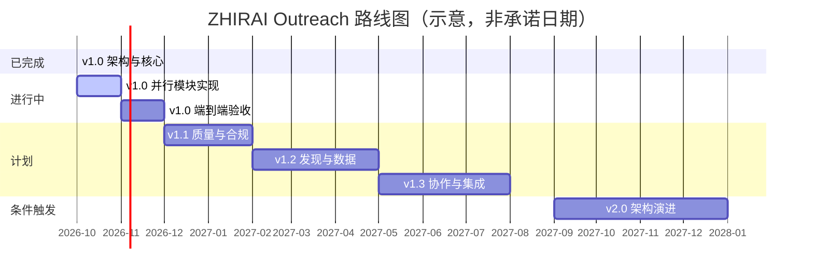

# 路线图（Roadmap）

> 项目：ZHIRAI Europe B2B AI Outreach Platform
> 作者：ZHIRAI · 智睿科技 · 独立开发者
> 原则：**一次只推进一个阶段**，每个阶段有明确范围、测试与可核实结果；不承诺未验证的能力。

---

## 0. 版本策略

| 版本 | 定位 | 兼容性承诺 |
| --- | --- | --- |
| `1.0.x` | 首个正式版 + 修复 | 数据库迁移只增不改；配置向后兼容 |
| `1.1.x`–`1.3.x` | 功能增强 | 保持 `/api/v1` 兼容；新增字段可选 |
| `2.0.0` | 可能引入架构变更（如 PostgreSQL 支持） | 提供迁移工具与说明 |

语义化版本；每个版本更新 [CHANGELOG.md](../CHANGELOG.md)。

---

## 1. v1.0.0（首个正式版，历史基线）

### 1.1 范围（v1.0 已交付）

| 模块 | 能力 | 状态 |
| --- | --- | --- |
| 租户与身份 | 单工作空间初始化、多成员、4 角色/25 capability、会话、API Key | ✅ |
| 产品与 ICP | 产品资料（规格/认证/产能/MOQ/交期/文件）、ICP（国家/地区/类型/规模/角色/关键词/排除/最低分） | ✅ |
| 企业与联系人 | 主数据、来源记录、校验记录、去重、邮箱可信度分级 | ✅ |
| 发现与补全 | 发现批次、CSV 导入、邮箱推断、MX 校验、企业官网抓取（`public_web` 发现适配器仍标记未实现） | ✅ |
| 评分与匹配 | 规则评分 `rules-v1`、A/B/C/D、因素/排除/解释、人工修正反馈 | ✅ |
| 活动与外发 | 活动/步骤/目标、草稿生成、审批、发送管线（五道闸） | ✅ |
| 邮件 | SMTP/MIME/IMAP、模拟邮箱、线程关联、退订链接 | ✅ |
| 回复与接管 | 11 类意向、置信度、依据、建议回复、高意向通知、6 态接管 | ✅ |
| CRM | 商机管道、活动时间线、跟进任务 | ✅ |
| Agent | 10 角色、Provider 抽象（OpenAI 兼容 + simulation）、服务端提示词、结构化输出、执行记录 | ✅ |
| 任务 | 数据库队列、Worker、重试/租约/取消/去重、12 类任务、全局暂停 | ✅ |
| 前端 | 15 个页面模块 / 16 条路由 + `/admin` 维护台 | ✅ |
| 运维 | 审计、用量、热备份、维护台、健康检查、许可证信息 | ✅ |
| 部署 | 零依赖、单进程、Windows/Linux、nginx/HTTPS 文档 | ✅ |
| 文档 | 架构/研究/许可证/数据模型/API/安全/合规/ADR/用户指南/部署/路线图 | ✅ |

> ✅ = 已实现并通过测试/验收（详见 [ARCHITECTURE.md](./ARCHITECTURE.md) 附录 C 与 [CHANGELOG.md](../CHANGELOG.md)）。

### 1.2 v1.0 明确**不实现**（非目标）

| 非目标 | 原因 |
| --- | --- |
| 无限量自动群发 | 违反产品定位与合规要求；可能毁掉客户域名声誉 |
| LinkedIn / WhatsApp 自动化 | 平台 ToS 与账号封禁风险高；v1.0 不做 |
| 内置邮件预热/代发服务 | 需要基础设施与声誉管理，非本项目范围 |
| 多租户 SaaS 平台（注册/计费/隔离托管） | 自托管形态优先；SaaS 需额外架构与合规 |
| 通用 EAV / 自定义对象引擎 | 过度设计（见 ADR-011） |
| 自动成交/自动报价 | 商务决策必须由人做 |
| 承诺"AI 越用越准" | 无依据（方案明确禁止） |
| 自研模型/训练 | 使用 Provider 抽象接入外部或本地模型 |
| 多副本水平扩展 | SQLite 单写；单机是支持拓扑 |
| 内置 WAF/防爬 | 由反向代理/云防护承担 |

### 1.3 v1.0 验收标准与结果（2026-10-22；v1.1 已更新为 309 测试 / 16-16 E2E）

- [x] 部署步骤验证：按 [DEPLOY.md](../DEPLOY.md) 启动、初始化、可登录（本机实例；干净机器复验建议发布前再做）。
- [x] `npm test` 通过（v1.0 验收时 274 项；v1.1 为 309 项）。
- [x] 关键业务链路可用：产品 → ICP → 发现 → 评分 → 草稿 → 审批 → 发送（受控/模拟邮箱）→ 回复分类 → 接管。
- [x] 接管后发送被拒绝（`scripts/verify-safety.mjs` 真实任务队列 + DB 状态验证；v1.0 时 15/15）。
- [x] 退订链接真实可用，退订后写入抑制（公开退订预览 + 提交 + 抑制可见）。
- [x] 前端 15 个页面模块 / 16 条路由真实浏览器验收通过。
- [x] 文档与代码一致（v1.0 时 154 条路由、40 张表；v1.1 为 161 条路由）。
- [ ] 备份与恢复演练（脚本与步骤已提供，尚未在实例上做真实恢复演练）。
- [ ] 真实外网 SMTP/IMAP 与真实模型 API（保持为发布前待验证项）。
- [x] 无真实密钥、无 `server/data` 进入发行包（打包规范与 `.gitignore` 已约束）。
- [x] **v1.1 追加**：`npm test` 309 项（308 通过 / 1 跳过）；安全/媒体 E2E 16/16；产品图片/PDF/关键词/附件流程通过真实浏览器验收（详见 [VERIFICATION.md](./VERIFICATION.md)）。

---

## 2. v1.1（已交付：产品资料与邮件附件）

**主题：让开发信"有资料可发"**

| 功能 | 说明 | 状态 |
| --- | --- | --- |
| 产品主图 | PNG/JPEG/WebP ≤8 MB，第一张自动主图，可切换/删除 | ✅ |
| 产品 PDF 资料 | PDF ≤8 MB，单产品 ≤100 个文件 | ✅ |
| AI 关键词 | 第 11 个 Agent `keyword_research`；生成/编辑关键词（≤30） | ✅ |
| 邮件 PDF 附件 | 草稿自动选最多 3 个 PDF；发送单 ≤5 MB、总 ≤8 MB；快照审计 | ✅ |
| 公开 PDF 链接 | HMAC 签名、180 天、按租户校验；仅 PDF 文档 | ✅ |
| 发现国家快捷选择 | 全选欧洲 / 随机 8 国 / 清空；0 国 = 全部市场 | ✅ |
| 发现关键词联动 | 选产品自动带出关键词；界面内 AI 生成 | ✅ |
| 数据迁移 | `002_product_media_attachments.sql`（ADD COLUMN） | ✅ |

**验收**：309 项测试（308 通过 / 1 跳过）、安全/媒体 E2E 16/16、浏览器验收 15 页面（详见 [VERIFICATION.md](./VERIFICATION.md)）。

### 2.2 v1.1 未包含（转入 v1.2）

| 功能 | 说明 | 优先级 |
| --- | --- | --- |
| robots.txt 解析与抓取限速 | 抓取前检查目标站点规则；尊重 `Crawl-delay` | 高 |
| 退信/投诉自动抑制闭环 | 硬退信 → 自动抑制；与熔断联动 | 高 |
| 邮件占位符校验 | 发送前检查 `{{...}}` 是否全部替换 | 高 |
| 数据主体请求（DSAR）工作流 | 一键导出个人数据包；删除/匿名化工具 | 高 |
| 保留清理任务强化 | `maintenance.retention` 已注册；补齐排除抑制/合法依据与可视化 | 高 |
| 发送前预览与测试发送 | 给自己/测试邮箱发预览，确认附件与链接 | 中 |
| 域名认证指引 | 页面内 SPF/DKIM/DMARC 检查提示（不代配） | 中 |
| 多语言模板管理 | 常用语种模板（EN/DE/FR/ES/IT/NL） | 中 |
| 批量操作增强 | 批量评分/批量审批/批量入组 | 中 |
| 报表 | 发送/回复/意向/成本周报 | 中 |

**风险**：抓取合规、退信判断误伤、DSAR 删除与审计留存冲突、附件被判定为垃圾邮件。

---

## 3. v1.2（发现与数据质量 + 质量合规）

**主题：更少的人工整理、更稳的发送**

| 功能 | 说明 | 优先级 |
| --- | --- | --- |
| 搜索 API 适配器实装 | 可配置搜索服务（用户自带密钥），返回候选企业 | 高 |
| 企业数据提供商适配器实装 | 可配置补全（用户自带密钥） | 中 |
| 官网结构化抽取增强 | 产品/认证/联系方式抽取模板 | 高 |
| 联系人角色推断 | 基于职位关键词映射 `role_category`（规则优先） | 中 |
| 企业去重与合并 | 同名/同域/相似地址合并工具（人工确认） | 中 |
| 数据质量看板 | 缺域名/缺邮箱/低置信度占比 | 中 |
| 导入增强 | XLSX（需评估零依赖方案）、字段映射 UI、错误行下载 | 中 |
| v1.1 未包含的质量/合规项 | 见 §2.2 | 高/中 |

**风险**：第三方 API ToS、费用控制、抓取被封。

---

## 4. v1.3（协作与集成）

**主题：从个人工具到团队工作台**

| 功能 | 说明 | 优先级 |
| --- | --- | --- |
| 工作空间切换 | 一个用户属于多个工作空间时无需重新登录 | 中 |
| 角色/权限细化 | 字段级权限、审批人限定 | 中 |
| 通知渠道 | 邮件/Webhook 通知（高意向、任务失败、审批待办） | 中 |
| Webhook 出站 | 事件推送（`lead.scored`、`draft.approved`、`reply.high_intent`） | 中 |
| MCP Server | 让外部 Agent 通过 MCP 访问受限业务接口 | 低 |
| OpenAPI 完善 | 覆盖全部端点、生成客户端示例 | 中 |
| 公开链接按条撤销 | 产品 PDF token 黑名单/撤销入口 | 中 |
| 富文本与附件预览 | 草稿富文本编辑、收件箱附件列表展示 | 低 |

**风险**：MCP/Webhook 的鉴权与限流；附件被判定为垃圾邮件。

---

## 5. v2.0（架构演进，条件触发）

**只在出现真实客户需求时启动**：

| 方向 | 触发条件 | 代价 |
| --- | --- | --- |
| PostgreSQL 支持 | 单库写入成为瓶颈 / 客户要求高可用 | 重写仓储 SQL、迁移工具、运维复杂度上升 |
| 独立 Worker 进程 | HTTP 与任务互相影响 | 进程间协调、部署复杂度 |
| 多副本 | 客户量级超单机 | 需要共享存储/队列、限流改为共享 |
| 插件机制 | 客户需要自定义抓取/评分 | 安全边界、版本兼容、许可证登记 |
| 多租户 SaaS | 商业模式转向托管 | 计费、隔离、合规（DPA/跨境）大幅增加 |

---

## 6. 不自动化承诺（长期）

以下承诺**不随版本改变**：

1. **不默认自动群发**：自动发送必须由用户显式开启，并受限额/窗口/熔断约束；人工审批默认开启。
2. **接管即停**：用户接管后，AI 不得自动发送回复或跟进；恢复必须由用户明确操作。
3. **退订优先**：退订/拒绝联系是最高优先级禁止状态，不能被"恢复自动化"绕过。
4. **不编造事实**：认证、产能、价格、客户案例、供应能力只能来自产品资料库或用户输入。
5. **不承诺准确率**：不宣传"AI 越用越准""命中率 90%"等无依据指标。
6. **不隐藏来源**：每条外部数据保留来源、时间与置信度。
7. **不做规避平台规则的功能**：不提供 LinkedIn/WhatsApp 自动化、不提供反检测/绕过验证码能力。
8. **不静默扩容**：发送限额的调整必须由用户操作并留审计。

---

## 7. 阶段划分与里程碑

> 日期为**规划示意**，不是交付承诺；实际节奏取决于客户反馈与验证结果。

---

## 8. 风险与依赖

| 风险 | 影响 | 缓解 |
| --- | --- | --- |
| 并行开发模块集成不通过 | 延期 | 契约先行 + 集成测试 + Lead 统一验收 |
| 真实 SMTP/IMAP 兼容性 | 发信失败 | 用多家邮箱（Gmail/Outlook/企业邮箱）做 E2E |
| 邮件送达率 | 客户体验差 | 默认限额/窗口/审批；文档指导域名认证与预热 |
| 合规差异（欧盟各国） | 法律风险 | [COMPLIANCE.md](./COMPLIANCE.md) + 专业复核 |
| AI 输出质量 | 客户不信任 | 合规/质量双检 + 审批 + 可追溯 |
| 单机性能上限 | 大客户流失 | 明确边界；v2.0 再评估 PostgreSQL |
| 零依赖限制功能 | 开发慢 | 接受；必要时评估"宽松许可少量依赖"（走登记流程） |
| Node 升级破坏 `node:sqlite` | 无法启动 | 锁定版本范围 + 封装单点 + 回归测试 |

---

## 9. 如何参与/反馈

- 缺陷与需求：xtang3125@gmail.com（附复现步骤、版本号、日志片段）。
- 商业授权与定制：同上。
- 安全问题：**不要公开披露**，见 [SECURITY.md](./SECURITY.md) §16。

---

**ZHIRAI · 智睿科技 · 独立开发者**
把想法变成现实 ｜ https://zhirai.cloud
© 2026 智睿科技 保留所有权利。

