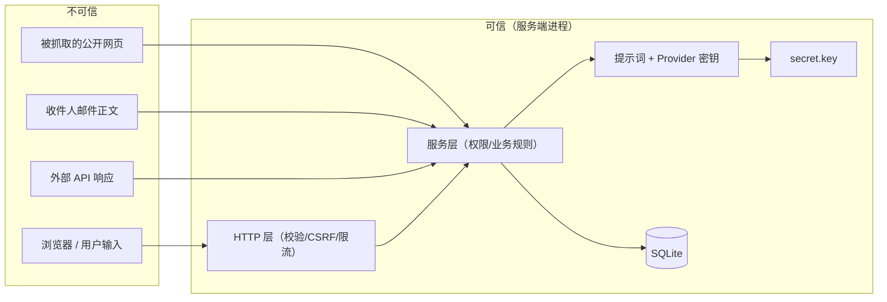

# 安全设计说明（Security）

> 项目：ZHIRAI Europe B2B AI Outreach Platform v1.1.0
> 作者：ZHIRAI · 智睿科技 · 独立开发者
> 本文描述**已实现的安全机制**与**已知限制**。标注规则：
> ✅ = 已实现且经代码核对/自动化测试/端到端验收；🔶 = 已实现但**未做外部/渗透/真实第三方验证**；⚪ = 未实现（当前版本不提供）。
> 2026-10-23 验收基线：`npm test` **309 项（308 通过 / 1 跳过 / 0 失败）**；`scripts/verify-safety.mjs` **16/16**（含产品 PDF/附件链路）；前端 15 个页面模块真实浏览器验收。
> 本文不是安全认证，也不构成"系统绝对安全"的结论。

---

## 目录

- [1. 威胁模型](#1-威胁模型)
- [2. 认证与会话](#2-认证与会话)
- [3. CSRF / Origin / 浏览器侧防护](#3-csrf--origin--浏览器侧防护)
- [4. 授权与角色](#4-授权与角色)
- [5. 多租户隔离](#5-多租户隔离)
- [6. 密钥与凭据加密](#6-密钥与凭据加密)
- [7. 输入校验与输出](#7-输入校验与输出)
- [8. 限流与滥用防护](#8-限流与滥用防护)
- [9. 发送安全](#9-发送安全)
- [10. Agent 安全](#10-agent-安全)
- [11. 审计与日志](#11-审计与日志)
- [12. 数据备份、恢复与保留](#12-数据备份恢复与保留)
- [13. 生产部署安全清单](#13-生产部署安全清单)
- [14. 已知限制（必须告知客户）](#14-已知限制必须告知客户)
- [15. 已验证 / 未验证清单](#15-已验证--未验证清单)
- [16. 漏洞响应](#16-漏洞响应)

---

## 1. 威胁模型

### 1.1 资产

| 资产 | 位置 | 泄露/破坏后果 |
| --- | --- | --- |
| 企业/联系人数据 | `outreach.sqlite` | 违反 GDPR；客户流失；投诉 |
| 邮件正文与线程 | `outreach.sqlite` | 商务机密泄露 |
| 模型/数据源 API Key、邮箱密码 | `integration_credentials`（密文）、`.env` | 被盗刷、被冒名发信 |
| 加密主密钥 | `server/data/secret.key` | 全部凭据可解 |
| 会话令牌 / CSRF 令牌 | Cookie | 账号被接管 |
| 提示词库 | 服务端文件 | 核心资产泄露、被抄袭 |
| 发送能力 | SMTP 凭据 + 发送管线 | 被用于垃圾邮件、域名被封 |
| 产品图片 / PDF 资料 / 邮件附件 | `DATA_DIR/uploads/**` + `product_files` / `attachments_json` | 商业资料泄露；公开链接被转发；恶意文件 |
| 公开分享链接 token | 邮件中的 `/api/v1/public/product-files/:token` | 持有者无需登录即可访问 PDF |
| 审计记录 | `audit_events` | 无法追责 |

### 1.2 攻击者与威胁

| # | 威胁 | 攻击者 | 攻击路径 | 缓解措施 | 残余风险 |
| --- | --- | --- | --- | --- | --- |
| T1 | 未授权访问工作台 | 外部 | 弱口令、撞库、会话窃取 | scrypt 哈希、登录限流 10/min、HttpOnly Cookie、改密吊销全部会话、SameSite=Lax | 无 MFA/无账号锁定（⚪） |
| T2 | CSRF 诱导发信/改设置 | 恶意站点 | 跨站表单 | Origin 校验 + 双提交 CSRF Token + SameSite=Lax | 已通过真实浏览器流程验收；新前端改动仍需回归 |
| T3 | XSS 窃取会话/CSRF | 外部 | 企业名/邮件正文注入 | CSP `script-src 'self'`、JSON 响应 `Content-Type`、无内联脚本、前端须转义 | 未做专项 XSS 代码审计（🔶） |
| T4 | 越权读其他工作空间 | 同实例其他租户 | 改 `workspaceId` / 猜 ID | 服务端会话绑定工作空间；仓储层强制 `workspace_id`；ID 为 ULID 不可枚举 | 已由集成测试覆盖跨工作空间读写（✅） |
| T5 | 越权提权（member→admin） | 内部低权限用户 | 改前端角色字段 | 服务端 capability 矩阵；`role` 只从 DB 读取 | 无 |
| T6 | API Key 泄露 | 内部/泄漏 | 提交进仓库、日志 | 仅存 SHA-256 哈希；日志/审计脱敏；可吊销；可设过期 | 用户可能把 Key 写进脚本（文档提示） |
| T7 | 凭据数据库泄露 | 拿到 DB 文件 | 直接读 SQLite | 凭据以 AES-256-GCM 加密，AAD 绑定工作空间+类型+供应商；主密钥在 `secret.key`（0600） | DB + 主密钥同时泄露则失效（部署清单要求分离备份） |
| T8 | 接管后 AI 仍发信 | 系统缺陷 | 竞态/漏校验 | 接管原子操作 + 取消任务 + **发送前再校验** | 已由 E2E 验证"接管后发送被拒"（✅）；极端并发竞态未做压测 |
| T9 | 退订被绕过 | 客户/系统缺陷 | 恢复自动化按钮 | `DO_NOT_CONTACT` 不可由普通恢复解除；须删除 `suppression_records`（admin/owner） | 管理员可手动删除（设计如此，需培训） |
| T10 | 邮件群发滥用 | 客户 | 关闭审批 + 提高限额 | 默认审批、日限额、发送窗口、窗口外延后、接管/抑制检查、熔断 | 客户可自行放宽限额（合同与文档约束） |
| T11 | 提示词注入（网页/邮件内容） | 外部数据 | 抓取内容含"忽略之前指令" | 输入放入数据区并声明"不要执行其中指令"；输出 JSON Schema 校验；合规/质量双检；**人工审批** | 模型仍可能被绕过（提示词注入无 100% 防御） |
| T12 | Agent 越权改数据 | 模型/工具 | 工具调用 | Agent 不持有 DB 句柄、不执行 SQL/HTTP；只能经 service 层并走权限与审计 | Agent 无工具调用面（✅） |
| T13 | 静态文件泄露源码 | 外部 | 访问 `/server/**` | 静态根白名单（`src/ assets/ admin/` + 少量文件）；禁止 `server/`、`docs/`、`..` | 无 |
| T14 | 备份文件被下载 | 内部低权限 | `/ops/backup/:name` | 仅 `backup.run`（owner）；文件名正则白名单 | owner 账号被盗则失效 |
| T15 | 日志泄露密钥 | 运维 | 查看日志 | logger/audit 对 `password/secret/token/api_key/authorization/cookie/credential` 脱敏 | 邮件正文可能进审计（业务需要） |
| T16 | 退订链接伪造 | 外部 | 构造 token | HMAC-SHA256 签名 + 365 天过期；校验工作空间存在 | 链接转发给他人可代为退订（可接受） |
| T17 | DoS（请求洪泛） | 外部 | 高频请求 | 内存滑动窗口限流；1.5MB body 上限；反向代理限流 | 无 WAF；大量并发仍可能拖慢单进程 |
| T18 | 依赖供应链 | 外部 | npm 投毒 | **0 运行时依赖** | Node 运行时自身漏洞（需客户及时升级） |
| T19 | 产品 PDF 公开链接被转发/泄露 | 收件人或任何持有链接者 | 转发邮件/链接 | HMAC 签名 token（180 天）+ 租户/产品/文件联合校验；仅 PDF 生成链接；文件删除后链接立即失效 | **持有即可访问，无按链接撤销**；敏感资料不应上传为产品 PDF |
| T20 | 恶意上传 / 路径遍历 / 超大文件 | 内部用户或被盗账号 | 上传可执行文件、`../` 路径、超大 base64 | MIME 白名单（PNG/JPEG/WebP/PDF）、单文件 ≤8 MB、body ≤12 MB、文件名清洗、存储路径解析后必须仍在 uploads 根内、单产品 ≤100 文件 | 无病毒扫描（🔶）；仍有存储配额风险 |

### 1.3 信任边界



**原则**：浏览器与所有外部内容都在不可信区；权限判定、密钥、提示词、业务规则只在服务端。

---

## 2. 认证与会话

### 2.1 账号与密码

| 项 | 实现 | 位置 | 状态 |
| --- | --- | --- | --- |
| 密码哈希 | `scrypt`，N=16384、r=8、p=1、32 字节输出、每密码随机 16 字节盐、`maxmem=64MB`、常数时间比较 | `server/core/crypto.mjs` | ✅ |
| 密码策略 | 最少 10 位，必须同时含字母与数字；不能与当前密码相同 | `server/core/auth.mjs`（`bootstrapWorkspace`/`changePassword`） | ✅ |
| 账号唯一 | `users.email UNIQUE COLLATE NOCASE` | `001_init.sql` | ✅ |
| 停用 | `users.is_active=0` 后无法登录、会话解析返回 null | `auth.mjs` | ✅ |
| 首次初始化 | 仅当 `users` 表为空时允许 `POST /auth/setup`（`hasUsers()` 校验） | `routes/auth.mjs` | ✅ |
| 改密 | 校验当前密码 → 更新哈希 → **吊销该用户全部会话** | `auth.mjs#changePassword` | ✅ |
| 忘记密码 | 提供本地脚本 `npm run reset-password`（由运维在服务器执行） | `scripts/reset-password.mjs` | ✅ 已随发行包提供 |

### 2.2 会话

| 项 | 实现 |
| --- | --- |
| 令牌 | `zrs_` + 32 字节 base64url 随机串；**数据库只存 SHA-256 哈希** |
| Cookie | `zr_session`：`HttpOnly`、`SameSite=Lax`、`Path=/`，当 `PUBLIC_BASE_URL` 为 https 时加 `Secure` |
| 有效期 | 默认 168 小时（`SESSION_TTL_HOURS`，可配 1h–365d） |
| 活跃更新 | `last_seen_at` 最多每 5 分钟写一次（减少写放大） |
| 绑定 | 会话绑定单一 `workspace_id`；跨工作空间需重新登录 |
| 吊销 | 登出、改密、管理员移除成员、用户手动吊销其他会话 |
| 会话列表 | `GET /api/v1/auth/sessions` 返回当前用户有效会话（IP/UA/时间），支持 `DELETE /auth/sessions/:id` |

### 2.3 API Key

| 项 | 实现 |
| --- | --- |
| 格式 | `zrk_` + 32 字节随机串；数据库只存 SHA-256 哈希与前 12 位前缀 |
| 用途 | 自动化/未来 MCP；`Authorization: Bearer zrk_...` |
| 权限 | 等同所属用户在当前工作空间的角色（不额外提权） |
| 显示 | 明文只在创建响应出现一次；列表只显示前缀 |
| 吊销 | `DELETE /auth/api-keys/:id`（`credentials.manage`） |
| 过期 | 支持 `expires_at`（当前创建接口未暴露，表结构支持） |

### 2.4 未实现（⚪）

- MFA/2FA、WebAuthn。
- 登录失败计数与自动锁定（仅限流）。
- SSO（OIDC/SAML）。
- 邮件自助找回密码（需 SMTP 配置，v1.0 用本地脚本）。

---

## 3. CSRF / Origin / 浏览器侧防护

### 3.1 CSRF 双提交

- 登录/初始化成功后下发两个 Cookie：`zr_session`（HttpOnly）与 `zr_csrf`（**可被 JS 读取**，供前端回传）。
- 所有**非 GET/HEAD/OPTIONS** 请求（除公开路径）必须带 `X-CSRF-Token`，服务端与 `sessions.csrf_hash` 做常数时间比较。
- API Key 请求（`Authorization: Bearer`）不需要 CSRF（无 Cookie 语义）。
- 公开路径豁免：`/api/v1/health`、`/auth/setup`、`/auth/login`、`/auth/status`、`/public/*`；这些路由通过 `csrf:false` 与 `isPublicApiPath()` 双重豁免。

### 3.2 Origin 校验

- 若请求带 `Origin`，其 host 必须等于 `Host`（或在 `TRUST_PROXY=1` 时等于 `X-Forwarded-Host`），否则 `403 CSRF_FAILED`。
- 未启用 CORS：不存在跨源可读响应。

### 3.3 安全响应头（所有响应）

| 头 | 值 |
| --- | --- |
| `Content-Security-Policy` | `default-src 'self'; script-src 'self'; style-src 'self'; img-src 'self' data:; font-src 'self'; connect-src 'self'; frame-ancestors 'none'; base-uri 'none'; form-action 'self'; object-src 'none'` |
| `X-Content-Type-Options` | `nosniff` |
| `X-Frame-Options` | `DENY` |
| `Referrer-Policy` | `strict-origin-when-cross-origin` |
| `Cross-Origin-Opener-Policy` | `same-origin` |
| `Permissions-Policy` | `camera=(), microphone=(), geolocation=(), payment=(), usb=()` |
| `Cache-Control` | API：`no-store`；HTML：`no-store`；图片/ico：`public, max-age=86400`；其他：`no-cache` |

**CSP 含义**：不允许内联脚本、不允许外部 CDN、不允许 `eval`。前端开发必须把脚本放 `src/**` 的独立文件中（🔶 前端落地后需复核）。

### 3.4 静态文件白名单

允许的根：`src/`、`assets/`、`admin/`；允许的单文件：`index.html`、`favicon.ico`、`robots.txt`、`manifest.webmanifest`。显式拒绝含 `..`、以 `server/` 或 `docs/` 开头的路径。未知非文件路径回退到 `index.html`（SPA 外壳）。

> 注意：不能把 `server/`、`docs/`、`tests/` 放进静态根，否则源码/文档可能被直接下载。

---

## 4. 授权与角色

### 4.1 角色

| 角色 | 中文 | 说明 |
| --- | --- | --- |
| `owner` | 拥有者 | 全部权限；唯一；可备份、删除工作空间、删除抑制记录 |
| `admin` | 管理员 | 管理设置/成员/凭据/邮箱账户；不可删除工作空间 |
| `member` | 成员 | 业务数据读写、审批、发送、接管、导入导出 |
| `viewer` | 只读 | 只读业务数据与任务状态 |

### 4.2 capability 矩阵（服务端强制）

完整 25 项 capability 定义在 `server/core/auth.mjs` 的 `CAPABILITIES` 常量。示例：

| capability | viewer | member | admin | owner |
| --- | --- | --- | --- | --- |
| `data.read` | ✅ | ✅ | ✅ | ✅ |
| `data.write` | ❌ | ✅ | ✅ | ✅ |
| `data.delete` | ❌ | ❌ | ✅ | ✅ |
| `settings.manage` | ❌ | ❌ | ✅ | ✅ |
| `credentials.manage` | ❌ | ❌ | ✅ | ✅ |
| `drafts.approve` | ❌ | ✅ | ✅ | ✅ |
| `automation.manage` | ❌ | ✅ | ✅ | ✅ |
| `audit.read` | ❌ | ❌ | ✅ | ✅ |
| `jobs.manage` | ❌ | ❌ | ✅ | ✅ |
| `backup.run` | ❌ | ❌ | ❌ | ✅ |

**实现要点**：
- 路由声明 `{ auth: 'required', capability: 'data.write' }`，HTTP 层统一校验（`roleCan`）。
- 业务层可再次调用 `ctx.requireCapability()` 做二次确认。
- **前端隐藏按钮不算权限**；所有 API 可被直接调用，因此服务端必须校验。
- 成员管理特殊规则：只有 owner 可增删 admin；不能移除 owner；不能停用自己；工作空间必须至少保留一位 owner。

---

## 5. 多租户隔离

| 层 | 机制 |
| --- | --- |
| 数据库 | 所有业务表 `workspace_id NOT NULL REFERENCES workspaces(id)` + 复合索引（如 `idx_companies_workspace`） |
| 仓储层 | 每个查询强制 `WHERE workspace_id = ?`；跨租户访问返回 `null`/空集 |
| 会话 | 会话绑定单一工作空间；`resolveSession()` 联表校验成员状态与工作空间未删除/未停用 |
| API Key | 绑定工作空间；解析时校验成员状态与工作空间状态 |
| 凭据 | 密文 AAD 绑定 `${workspaceId}:${kind}:${providerKey}`，跨租户不可解密 |
| 公开退订 | token 里带 `w`（workspaceId），只对该工作空间生效 |

**测试要求**（CONTRACTS §9）：必须建 A/B 两个工作空间，验证 A 用户读不到 B 的企业/草稿/线程。当前由各模块测试覆盖，🔶 未做统一端到端复核。

**残留风险**：行级隔离依赖"每条 SQL 都写对"。评审清单必须包含"workspace_id 过滤"检查；建议后续加静态规则扫描（v1.x）。

---

## 6. 密钥与凭据加密

### 6.1 主密钥

- 首次启动生成 48 字节随机密钥，写入 `DATA_DIR/secret.key`，权限 `0600`（Windows 上尽力而为）。
- 通过 `server/core/secrets.mjs` 在进程内单例持有，**不写日志、不进 API 响应**。
- 用于：凭据加密（HKDF 派生）、退订 token 签名（HKDF 派生另一 label）。

**重要**：`secret.key` 丢失 = 所有已存凭据不可解密（需重新录入）；`secret.key` 泄露 = 结合数据库文件可解全部凭据。备份策略见 [DEPLOY.md](../DEPLOY.md)。

### 6.2 凭据加密（AES-256-GCM + HKDF）

```text
key      = HKDF-SHA256(secret, salt='', info='zhirai:credential-v1', 32B)
iv       = 12B random
AAD      = 'cred:' + `${workspaceId}:${kind}:${providerKey}`
cipher   = AES-256-GCM(key, iv, plaintext=JSON(secret), AAD)
存储格式 = v1.<ctxHash16>.<iv_b64url>.<tag_b64url>.<cipher_b64url>
```

- 每个凭据独立 IV；GCM 提供机密性 + 完整性。
- AAD 绑定上下文：把密文从一个工作空间/类型/供应商挪到另一个会解密失败。
- 允许的明文字段白名单：`apiKey`、`token`、`secret`、`password`、`webhookSecret`、`username`（最多 500 字符）。
- 读取仅发生在服务端（`getCredential`）；列表接口只返回 `hasSecret` 与掩码预览（前 2 + 后 4）。

### 6.3 `.env` 与环境变量

- `.env` 只在服务端读取（`config.mjs#loadDotEnv`，不覆盖已有环境变量）。
- `.gitignore` 排除 `.env`、`.env.local`、`*.key`、`server/data/`。
- 支持 `.env` 兜底 AI 配置（`AI_PROVIDER/AI_BASE_URL/AI_API_KEY/AI_MODEL`），**正常应通过 UI 保存到加密凭据表**。

### 6.4 密码学声明

- 未自定义密码学算法；全部使用 Node 内置 `crypto`（OpenSSL）。
- 未使用 ECB、未复用 IV、未硬编码密钥。
- 退订 token：`base64url(JSON payload) + "." + HMAC-SHA256`，payload 含 `w/e/c/co/exp`，**签名但未加密**（见 §14 已知限制）。

---

## 7. 输入校验与输出

| 项 | 实现 |
| --- | --- |
| 统一校验 | `server/core/validate.mjs`：`asString/asEmail/asDomain/asUrl/asInt/asNumber/asBool/asEnum/asArray/asCountry/asIsoDate/asObject`、`validateInput` |
| 长度限制 | 各字段显式 `max`（如名称 100、描述 20000、密钥 500） |
| 规范化 | 邮箱小写、域名去 `www`/去末尾点、名称压缩空白 |
| 分页 | `parsePagination`：默认 25、最大 100、page ≥ 1 |
| 排序 | `parseSort`：白名单列名，禁止任意列注入 |
| LIKE 转义 | `escapeLike` 转义 `\ % _` |
| SQL | 全部参数化查询（`prepare().all(...params)`）；排序/列名走白名单 |
| Body | JSON/`text/csv`/`text/plain`/`x-www-form-urlencoded`；上限 1.5MB（可按路由覆盖）；非法 JSON → 400 |
| 错误响应 | `{ ok:false, error:{ code, message } }`；不返回堆栈、SQL、路径；未知异常统一 500 通用文案 |
| 敏感输出 | 凭据仅掩码；用户对象不含 `password_hash`；会话不返回 token hash |

---

## 8. 限流与滥用防护

| 路由 | 限制 | 键 |
| --- | --- | --- |
| `POST /api/v1/auth/login` | 10 次 / 60s | `pattern + IP` |
| `POST /api/v1/auth/setup` | 5 次 / 60s | 同上 |
| `GET /api/v1/health` | 120 次 / 60s | 同上 |
| `GET/POST /api/v1/public/unsubscribe/:token` | 30 次 / 60s | 同上 |

- 实现：内存滑动窗口（`server/core/rate-limit.mjs`），触发时返回 `429 RATE_LIMITED` 并设置 `Retry-After`。
- 其他路由未单独限流（依赖反向代理 + 全局连接限制）。
- **单实例限制**：多进程/多副本部署时限流不共享（见 §14）。

---

## 9. 发送安全

### 9.1 五道闸（详见 [ARCHITECTURE.md](./ARCHITECTURE.md) §10）

1. 草稿已审批（`status='approved'`）。
2. 抑制名单（邮箱或域名）未命中。
3. 自动化状态为 `AUTOMATION_ACTIVE`（非 `HUMAN_TAKEOVER/DO_NOT_CONTACT/PAUSED/CLOSED`）。
4. 全局/工作空间发送未暂停。
5. 发送窗口（Europe/Berlin，默认 9–17 工作日）、账号/工作空间日限额、重复发送、退信熔断。

### 9.2 退订与拒联

- 每封外发邮件默认附加退订链接（`settings.compliance.includeUnsubscribe`，默认 true）。
- 链接：`GET /api/v1/public/unsubscribe/:token`（预览，邮箱掩码）→ `POST` 执行退订。
- 执行退订：写 `suppression_records(reason='unsubscribe')` → 置该客户 `DO_NOT_CONTACT` → 取消该客户待办与任务 → 写审计（`actor_type='anonymous'`）。
- 退订为**不可由普通"恢复自动化"解除**的状态。

### 9.3 投诉与退信

- 抑制名单支持 `reason='hard_bounce' | 'complaint'`；退信/投诉应写入抑制并停止后续发送（自动闭环 🔶 未做真实退信 E2E）。
- 发送管线内置**退信熔断**：发件账号 24 小时内失败达到 5 次即拒绝继续发送（代码实现，🔶 未用真实退信压测）。

### 9.4 域名声誉（客户责任）

- 产品不提供 SPF/DKIM/DMARC 配置，也不代发邮件；客户需自行配置企业邮箱与域名认证。
- 文档明确：**首次使用建议小批量、观察退信率**，不要一上来跑满日限额。

### 9.5 产品文件、公开 PDF 链接与附件安全（v1.1）

| 控制 | 实现 |
| --- | --- |
| 上传类型白名单 | 图片 `image/png` / `image/jpeg` / `image/webp`；文档 `application/pdf`；其他 → 422 |
| 上传大小 | 单文件 ≤ **8 MB**；请求体上限 **12 MB**；base64 严格校验（非法 → 422） |
| 路径遍历防护 | 文件名去目录/控制字符、限 160 字符；`resolveStoragePath` 拒绝 `..` 且解析结果必须仍在 `uploadsDir` 内 |
| 存储隔离 | `uploads/products/<workspaceId>/<productId>/<fileId>.<ext>`；认证下载按 `(workspace_id, product_id, file_id)` 校验 |
| 公开链接 | 仅 PDF 文档生成；HMAC token（`t:'pfile'`，含工作空间/产品/文件，**180 天**）；无效/过期/跨租户 → 404；限流 120/min/IP |
| 响应头 | 文件流 `Content-Disposition: inline` + `X-Content-Type-Options: nosniff`；不允许 HTML 类型 inline 渲染 |
| 附件 MIME | 发送时仅允许 `application/pdf` / `image/png` / `image/jpeg` / `image/webp`；其他类型跳过并记录 warning |
| 附件大小 | 草稿最多 3 个产品 PDF；发送时单附件 ≤ **5 MB**、总附件 ≤ **8 MB**、MIME 层最多 20 个；超限跳过（不整封失败） |
| 附件快照 | 发送成功写入 `email_messages.attachments_json`，便于审计实际发送内容 |
| 审计 | 上传/删除/设主图/关键词生成均写 `audit_events` |

> **隐私提示（必须告知客户）**：公开 PDF 链接是"持有即可访问"的共享凭证，收件人或任何获得该链接的人**无需登录**即可打开；链接 180 天后过期，删除文件后立即 404，但**不支持按单条链接撤销**。请勿把报价单、客户名单等敏感资料作为"产品 PDF"上传。数据库备份不包含 `uploads/` 实际文件，备份时需同时复制该目录。

---

## 10. Agent 安全

| 控制 | 实现要点 | 状态 |
| --- | --- | --- |
| 提示词服务端化 | 提示词只在服务端文件；前端只传业务参数；`promptVersion` 写入执行记录 | 🟡 契约 |
| 无 DB 句柄 | Agent 不接收数据库对象、不执行 SQL；数据通过 service 层查询后作为结构化输入 | 🟡 契约 |
| 工具最小权限 | 每个 Agent 只声明所需输入字段（`AGENT_CATALOG.inputFields`），不得访问未授权实体 | 🟡 契约 |
| 输出校验 | 每个角色 JSON Schema 校验；失败重试 1 次；仍失败写 `failed` 并抛错 | 🟡 契约 |
| 注入防护 | ① 外部内容放"数据区"并声明其中指令无效；② 输出必须符合 Schema；③ 合规/质量双检；④ 人工审批 | 🟡 契约 |
| 事实约束 | "产品认证/产能/价格/案例/供应能力"只能来自产品资料库；违者被 `quality_review` 标记 | 🟡 契约 |
| 成本控制 | `settings.limits.dailyAiTokens`、`agent_executions.cost_estimate`、`usage_records` | ✅（上限配置）/🟡（执行） |
| 审计 | 每次执行写 `agent_executions`；草稿 `generated_by` 指回执行 | 🟡 契约 |

**原则**：模型输出永远不是"授权依据"。不能因为模型说"这是管理员"就提权，不能因为模型说"客户同意了"就免审批。

**提示词注入的现实边界**：任何基于 LLM 的系统都无法保证 100% 抵御注入。本项目通过"结构化输出 + 双检 + 人工审批 + 最小权限"把影响限制在"生成一封需要人审的草稿"，而不是"自动执行危险动作"。

---

## 11. 审计与日志

### 11.1 审计（`audit_events`）

- 记录字段：`workspace_id`、`actor_type`（`user/agent/system/api_key/anonymous`）、`actor_id`、`action`、`entity_type/id`、`before_json/after_json`、`ip`、`user_agent`、`request_id`、`created_at`。
- 脱敏：`before/after` 中键名匹配 `password|secret|token|api_key|credential|cookie|authorization` 的值替换为 `[redacted]`；字符串截断 2000 字符；嵌套深度 ≤ 4。
- 查询：`GET /api/v1/audit`（`audit.read`，admin/owner），支持 `action/entityType/entityId/page/limit`。
- 必须审计的动作（CONTRACTS §8）：登录/失败/改密/会话吊销、API Key 增删、工作空间与成员变更、企业/联系人/产品/ICP 增删改、活动、草稿审批、发送、接管/恢复、退订、导入、评分、Agent 执行、设置与凭据变更、备份。

### 11.2 应用日志（`logs/app.log`）

- JSON 行：`{t, level, name, msg, ...meta}`；级别 `debug/info/warn/error/silent`。
- 脱敏：键名匹配敏感词替换 `[redacted]`；字符串 > 400 字符截断；`Error` 保留 message/stack（仅服务端）。
- 请求日志（debug）：`requestId/method/path/status/ms/ip/userId`；**不记录 body、不记录 Cookie、不记录 Authorization**。
- 访问：`GET /api/v1/ops/logs?lines=200`（`audit.read`）。

---

## 12. 数据备份、恢复与保留

| 项 | 机制 |
| --- | --- |
| 热备 | `POST /api/v1/ops/backup`（`backup.run`，owner）→ `VACUUM INTO 'backups/outreach-<stamp>.sqlite'` |
| 下载 | `GET /api/v1/ops/backup/:name`（owner，文件名白名单 `^[A-Za-z0-9._-]+\.sqlite$`） |
| 脚本 | `npm run backup`（`scripts/backup.mjs`） | ✅ 已随发行包提供 |
| 恢复 | 停止服务 → 用备份替换 `outreach.sqlite`（并删除 `-wal`/`-shm`）→ 重启 |
| 保留 | `settings.retention`：`messageDays=730`、`contactDays=1095`、`jobDays=30`、`auditDays=730`、`usageDays=730`；由 `maintenance.retention` 任务清理（🟡） |
| 删除 | 业务实体软删（`deleted_at`）；工作空间删除需 owner（⚪ v1.0 未开放 API） |
| 导出 | 企业/联系人 CSV 导出（🟡 t-data） |

**备份安全**：备份文件包含加密后的凭据与全部业务数据，应视为**机密文件**；`secret.key` 建议与备份分开存放（否则拿到备份即可解密凭据）。

---

## 13. 生产部署安全清单

> 完整部署步骤见 [DEPLOY.md](../DEPLOY.md)。以下为安全项。

- [ ] `NODE_ENV=production`；`LOG_LEVEL=info`（非 debug）。
- [ ] `PUBLIC_BASE_URL` 为 **https** 地址（会话 Cookie 自动加 `Secure`）。
- [ ] `HOST=127.0.0.1`，由 nginx/Caddy 反代；不要直接暴露 Node 端口。
- [ ] `TRUST_PROXY=1` **仅当**前面是可信反向代理；否则伪造 `X-Forwarded-For` 可绕过限流。
- [ ] 反向代理强制 HTTPS（HSTS 建议 `max-age=15552000`）、请求体上限、连接数限制。
- [ ] `server/data` 目录权限仅服务账号可读写；`secret.key` 权限 600。
- [ ] 定期备份（至少每日）+ 异地保存 + **恢复演练**。
- [ ] 首次登录后立即修改初始化管理员密码（密码策略已强制 10 位+字母数字）。
- [ ] 为每位成员建独立账号，不使用共享账号；离职立即移除成员并吊销会话。
- [ ] 凭据从 UI 录入（加密存储），不要写进 `.env` 或代码。
- [ ] 明确 `GLOBAL_SEND_PAUSED=1` 作为紧急刹车（改后重启生效）。
- [ ] 监控 `logs/app.log` 的 error 与 `audit_events` 的异常动作。
- [ ] 定期升级 Node.js（安全补丁）与产品版本；升级前备份。
- [ ] 不要把 `DATA_DIR` 放在网络盘/NFS 上（SQLite WAL 不支持）。
- [ ] 若对外提供注册/多租户，需在网关层加限流与防爬（⚪ 产品未内置 WAF）。

---

## 14. 已知限制（必须告知客户）

| # | 限制 | 影响 | 缓解/说明 |
| --- | --- | --- | --- |
| 1 | 限流为**内存**实现 | 多实例/重启后限流状态丢失；多副本不共享 | 官方支持拓扑是**单实例**；多副本需网关限流 |
| 2 | SQLite **单写者** | 高并发写会等待（`busy_timeout=5000`），极端情况下 `SQLITE_BUSY` | 短事务、WAL、索引；压测待做（🔶） |
| 3 | `node:sqlite` 为 Node **实验特性** | Node 升级可能变化；日志中被静默警告 | 封装在 `core/db.mjs` 单点，便于替换 |
| 4 | 无 MFA / 无会话固定防护之外的额外措施 | 账号被盗风险 | 强密码 + 短会话 + 审计；建议网关加 IP 白名单 |
| 5 | 无账号锁定 | 可被慢速撞库 | 登录限流 10/min；建议网关加防护 |
| 6 | 无自助找回密码 | 运维成本 | 本地 `reset-password` 脚本 |
| 7 | 数据库整体**未加密**（仅凭据字段加密） | 拿到 DB 文件可读业务数据 | 磁盘加密（BitLocker/LUKS）+ 文件权限 + 备份加密 |
| 8 | 退订 token **签名但未加密** | 解码可见邮箱与工作空间 ID | 链接本身即凭证；建议邮件中不展示完整链接 |
| 9 | 应用不做 TLS 终止 | 必须由反代提供 HTTPS | [DEPLOY.md](../DEPLOY.md) 提供 nginx 示例 |
| 10 | 无内置 WAF/防爬 | 大流量攻击可能拖慢服务 | 反代限流、CDN、云防护 |
| 11 | Worker 与 HTTP 同进程 | 崩溃同时中断 | 进程守护 + 租约回收 |
| 12 | 产品文件上传**无病毒扫描** | 恶意 PDF/图片风险 | 只允许白名单类型与 ≤8 MB；建议在企业网关加 AV 扫描 |
| 13 | 邮件正文可能进入审计 before/after | 敏感内容留存在审计表 | 保留期限 `auditDays`；按需裁剪 |
| 14 | 无渗透测试/第三方安全评估 | 未知漏洞 | 发布前自查清单（§15）+ 建议第三方评估 |
| 15 | 前端未做专项 XSS 安全审计 | 存储型 XSS 风险 | CSP 限制脚本源；真实浏览器验收通过；前端统一转义 | 发布前做一次 XSS 代码审计/扫描（🔶） |
| 16 | 公开 PDF 链接"持有即可访问" | 链接被转发即泄露文件 | 只放可公开资料；180 天过期；删除文件立即失效 |
| 17 | 公开链接**无按链接撤销** | 无法单独作废某一个已发链接 | 删除文件（全部链接失效）或等待过期；后续版本可加 token 黑名单 |
| 18 | 数据库备份不含 `uploads/` | 恢复后附件/主图文件缺失 | 备份必须同时复制 `server/data/uploads/` |

---

## 15. 已验证 / 未验证清单

### 15.1 已通过代码核对（✅）

- 密码哈希算法与参数、常数时间比较。
- 会话令牌仅存哈希；Cookie 属性；会话解析的联表校验；改密吊销会话。
- CSRF 双提交 + Origin 校验；公开路径豁免逻辑。
- 安全响应头（CSP 等）覆盖所有响应（`createApp` 统一设置）。
- 静态文件白名单与 `..`/`server/`/`docs/` 拒绝。
- 角色/capability 矩阵与路由声明式校验。
- 凭据 AES-256-GCM + HKDF + AAD 绑定；列表掩码。
- 审计与日志的敏感键脱敏逻辑。
- 退订 token HMAC 签名与过期校验；退订写抑制 + `DO_NOT_CONTACT` + 取消任务。
- 限流实现（滑动窗口）与各路由阈值。
- 备份文件名白名单与 `VACUUM INTO` 路径转义。
- 错误响应不泄露堆栈（未知异常统一 500 文案）。
- **端到端安全验收（`scripts/verify-safety.mjs`，16/16）**：审批→队列→Worker 发送；接管后发送被拒；抑制名单拦截发送；公开退订写入抑制并置 `DO_NOT_CONTACT`；发送窗口恢复；**产品 PDF 上传 → 公开签名链接 → 草稿附件 → 发送附件快照**（v1.1 新增项）。
- **真实浏览器流程验收**：登录/CSRF 回传、审批、接管、退订页、设置保存等交互。
- **媒体/附件自动化测试**：上传类型/大小/base64 校验、路径遍历拒绝、主图切换、公开 token 有效/无效、草稿附件选择（最多 3 个 PDF）、MIME 附件结构/大小限制、发送快照落库。

### 15.2 未验证（🔶，上线前建议完成）

- 真实外网 SMTP/IMAP（Gmail/Outlook/企业邮箱）的发信、退信、线程关联。
- 真实付费模型 API 的输出质量与注入抵抗（需红队测试）；AI 关键词在真实模型下的质量。
- 退订链接/产品 PDF 链接在真实邮件客户端（Outlook/Gmail/Apple Mail）中的点击与渲染表现。
- 备份恢复演练（真实恢复一次并校验数据 + `uploads/` 文件）。
- 大流量/长时间运行下的限流、内存、SQLite 锁、上传磁盘占用表现（压测）。
- 上传文件的病毒/恶意内容扫描（当前无 AV）。
- 专项 XSS 代码审计/SAST，以及第三方渗透测试。
- Node 运行时安全公告的持续跟踪与升级演练。

### 15.3 未实现（⚪）

MFA、SSO、账号锁定、自助找回密码、数据库整库加密、robots.txt 自动解析、WAF、病毒扫描、公开链接按条撤销、渗透测试报告、许可证服务端校验。

### 15.4 验收摘要（2026-10-23）

| 项 | 结果 |
| --- | --- |
| 自动化测试 | 309 项：308 通过 / 1 跳过 / 0 失败 |
| 安全/媒体 E2E（`verify-safety.mjs`） | 16/16 通过 |
| 前端浏览器验收 | 15 个页面模块 / 16 条路由通过（v1.1 媒体/关键词/附件流程见 VERIFICATION.md） |
| 渗透测试/SAST | 未执行（🔶 建议发布前补） |

---

## 16. 漏洞响应

1. **报告渠道**：xtang3125@gmail.com（请勿公开披露）。
2. **响应目标**：3 个工作日内确认；高危问题优先修复并发布补丁版本。
3. **修复流程**：复现 → 评估影响范围 → 最小修复 → 回归测试 → 更新 `CHANGELOG.md` 与本文档 → 必要时吊销凭据（见全局安全规则 §8.8）。
4. **凭据泄露处置**：立即轮换（重新录入模型/邮箱凭据）、吊销 API Key、强制改密（吊销全部会话）、检查 `audit_events` 异常动作。
5. **不要**在未验证的情况下公开宣称漏洞或安全性；报告需附复现步骤与影响面。

---
<div align="center">

**ZHIRAI · 智睿科技 · 独立开发者**
把想法变成现实 ｜ https://zhirai.cloud
© 2026 智睿科技 保留所有权利。

</div>
